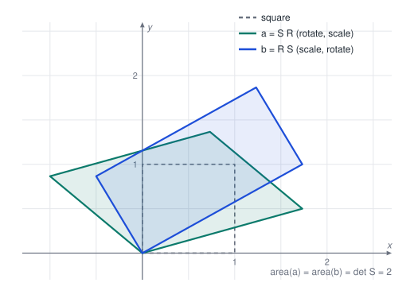

# Vectors and matrices

Joint angles, end-effector positions, wheel speeds, and sensor readings are all
expressed as vectors, and the relationships between coordinate frames are expressed
as matrices. Later lessons (rotation representations, coordinate transforms,
kinematics, control) reuse this lesson's notation directly, so concentrate on the
**geometric meaning** rather than on the arithmetic.

## Where you will use this

Turning a robot arm's joint angles into a hand position, moving an object seen by a camera into the
robot's own coordinates, and rotating thousands of LiDAR points at once are each one line of matrix
multiplication. The vector and matrix operations of this lesson come back in the rotations and
coordinate transforms of M1, the kinematics of M2 and the Kalman filter of M5 (covariance matrices).
Getting used to "the order of multiplication changes the result" here saves many frame bugs later.

## Concepts

### Vectors

A vector is a quantity with magnitude and direction. This curriculum uses column
vectors $\mathbf{a} = [a_x, a_y, a_z]^T$ by default. Remember that the same arrow
has different numbers depending on **which frame its components were read in**.
That is the central theme of the next few lessons.

- The **dot product** returns a scalar. Use it to find the angle between two
  vectors or to project one vector onto another direction. A dot product of zero
  means the vectors are perpendicular.
- The **cross product** is defined only in three dimensions and returns a vector
  perpendicular to both inputs. Its direction follows the right-hand rule and its
  magnitude is the area of the parallelogram the two vectors span. In robotics it
  shows up in rotation axes, in torque $\boldsymbol{\tau} = \mathbf{r} \times \mathbf{f}$,
  and in the velocity of a point on a rotating rigid body,
  $\mathbf{v} = \boldsymbol{\omega} \times \mathbf{r}$.

### A matrix is a linear transformation

A matrix $A$ is a linear transformation that sends vectors to other vectors. Each
column of $A$ is where the basis vector $\mathbf{e}_1, \mathbf{e}_2, \dots$ lands
after the transformation. This one viewpoint lets you read a rotation matrix as
"the new coordinate axes listed as columns."

The matrix product $AB$ is the composition "first $B$, then $A$." In general
$AB \neq BA$, and that is exactly why "rotate then translate" and "translate then
rotate" give different results on a robot.

### Inverse, transpose, determinant

- The inverse $A^{-1}$ undoes the transformation. If $\det A = 0$ there is no
  inverse (information about some direction has been lost). This connects to
  **singularities** in the inverse kinematics of M2.
- Rotation matrices $R$ are special: $R^{-1} = R^T$ and $\det R = 1$. Because
  inverting reduces to transposing, robot software uses this constantly.



## Key formulas

$$\mathbf{a}\cdot\mathbf{b} = \mathbf{a}^T\mathbf{b} = |\mathbf{a}||\mathbf{b}|\cos\theta$$

$$\mathbf{a}\times\mathbf{b} = [\mathbf{a}]_\times \mathbf{b}, \quad
[\mathbf{a}]_\times = \begin{bmatrix} 0 & -a_z & a_y \\ a_z & 0 & -a_x \\ -a_y & a_x & 0 \end{bmatrix}$$

$$(AB)^T = B^T A^T, \qquad (AB)^{-1} = B^{-1} A^{-1}$$

The 2D rotation matrix:

$$R(\theta) = \begin{bmatrix} \cos\theta & -\sin\theta \\ \sin\theta & \cos\theta \end{bmatrix}$$

$[\mathbf{a}]_\times$ (a skew-symmetric matrix) turns the cross product into a
matrix product. It reappears in Modern Robotics Ch. 3 when angular velocity comes
up, so get comfortable with it now.

## Example

Rotate the corners of a square by 30°, then stretch it by a factor of two along
x, and check whether swapping the order changes the result.

```python
import numpy as np

th = np.deg2rad(30)
R = np.array([[np.cos(th), -np.sin(th)], [np.sin(th), np.cos(th)]])
S = np.diag([2.0, 1.0])

square = np.array([[0, 1, 1, 0], [0, 0, 1, 1]], dtype=float)  # each column is a point

a = S @ R @ square  # rotate, then scale
b = R @ S @ square  # scale, then rotate
print(np.allclose(a, b))  # False: order matters
print(np.allclose(R.T @ R, np.eye(2)))  # True: R^T = R^{-1}
print(np.linalg.det(R))  # 1.0

u, v = np.array([1, 0, 0]), np.array([0, 1, 0])
print(np.dot(u, v), np.cross(u, v))  # 0, [0 0 1]
```

**Exercise:** extend the code above with `matplotlib` to draw the original square
together with `a` and `b` so you can see the difference. Then explain the relation
between $\det S$ and the area after the transformation.

```expected
The corners come out as follows (three decimals).

| Shape | Corners | What it is |
| --- | --- | --- |
| `a = S @ R @ square` | (0, 0), (1.732, 0.5), (0.732, 1.366), (−1, 0.866) | a parallelogram (about 123° at the origin) |
| `b = R @ S @ square` | (0, 0), (1.732, 1), (1.232, 1.866), (−0.5, 0.866) | a 2×1 rectangle turned by 30° |

Rotating first lets the scaling stretch the tilted sides along x only, which breaks the right angles.
Scaling first makes a rectangle that is then turned as a whole. Both shapes have area 2, which equals
$\det S = 2$ (a rotation has $\det R = 1$ and leaves areas alone). In general the area after a linear
map is the original area times $|\det|$.
```

## Self-check questions

1. If the dot product of two vectors is negative, what do you know about the angle between them?
2. What does the first column of a matrix $A$ mean geometrically?
3. Why can the inverse of a rotation matrix be computed as a transpose, and why does that fail for a general matrix?

## How to study this stage

1. **Videos (about 1.5 hours):** watch the vectors, linear combinations, linear transformations, matrix multiplication, 3D transformations, and cross product episodes of 3Blue1Brown's *Essence of Linear Algebra*. The goal is the intuition "a matrix transforms space," not the arithmetic.
2. **This lesson:** read the concepts and key formulas, and run the example code yourself.
3. **Textbook:** skim the "Linear Algebra Review" page on the Modern Robotics wiki and mark only the terms you do not know (determinant, eigenvalue).
4. **Problems:** take the quiz in the Korean original (`rc quiz m1-vectors-matrices`), then do the exercise (drawing the transformed square).
5. **Optional reinforcement:** if determinants and inverses feel shaky, work through the matching lectures and problem sessions of MIT 18.06SC.

## References

- Kevin M. Lynch, Frank C. Park, *Modern Robotics: Mechanics, Planning, and Control*,
  Cambridge University Press, 2017 — free preprint, linear algebra review page, and
  lecture videos: <http://hades.mech.northwestern.edu/index.php/Modern_Robotics>
- 3Blue1Brown, *Essence of Linear Algebra* (YouTube series) —
  <https://www.youtube.com/playlist?list=PLZHQObOWTQDPD3MizzM2xVFitgF8hE_ab>
- Gilbert Strang, MIT 18.06SC Linear Algebra (MIT OpenCourseWare) —
  <https://ocw.mit.edu/courses/18-06sc-linear-algebra-fall-2011/>
