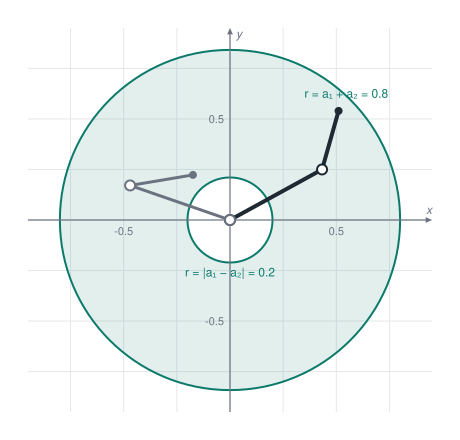

# Forward kinematics

Forward kinematics (FK) answers "if I turn the joints like this, where does the
fingertip go?" It is the function from joint values
$\boldsymbol{\theta} = (\theta_1, \dots, \theta_n)$ to the end-effector pose
$T_{0n}$, and its answer is always **unique**. The next lesson, inverse
kinematics, is the problem of running this function backwards, and the control and
planning algorithms from M3 onward call FK over and over.

## Where you will use this

"Where is the hand when the joints are turned this far" is the computation arm software does most
often. A simulator drawing the arm, a collision checker locating the links, and a wrist camera moving
what it sees into floor coordinates all call forward kinematics. The workspace, which decides
whether an arm you are buying or designing reaches the end of the shelf, comes from it too. Inverse
kinematics in the next lesson is this function solved backwards.

## Concepts

### Joint space and task space

- **Joint space:** the space of joint values. For an arm with $n$ degrees of freedom it is $n$-dimensional.
- **Task space:** the space of end-effector positions and orientations. In the plane it is $(x, y, \phi)$; in three dimensions it is $SE(3)$.

FK is the map from joint space to task space. The set of points the end effector
can reach is called the **workspace**.

### A product of link transforms

Multiply the link transforms $T_{i-1,i}(\theta_i)$ built in the DH lesson in order
from the base to the end effector. The composition rule from M1
($T_{ac} = T_{ab}T_{bc}$) applies unchanged. It is also common to multiply a fixed
transform such as a tool (gripper) frame $T_{n,\text{tool}}$ at the end.

### Another approach: the product of exponentials (PoE)

Instead of DH, Modern Robotics uses the screw axis of each joint together with the
zero-position pose $M$ to write
$T = e^{[\mathcal{S}_1]\theta_1}\cdots e^{[\mathcal{S}_n]\theta_n}M$. There is no
need to attach a frame to every link, so there are fewer mistakes to make. The
result is the same as DH, so this curriculum teaches DH first and leaves PoE to
the references.



## Key formulas

$$T_{0n}(\boldsymbol{\theta}) = T_{01}(\theta_1)\,T_{12}(\theta_2)\cdots T_{n-1,n}(\theta_n)$$

For a 2-link planar arm (with the shorthand $c_1 = \cos\theta_1$,
$c_{12} = \cos(\theta_1+\theta_2)$, and so on):

$$x = L_1 c_1 + L_2 c_{12}, \qquad y = L_1 s_1 + L_2 s_{12}, \qquad \phi = \theta_1 + \theta_2$$

With no joint limits, the workspace is an annulus centered on the base:

$$|L_1 - L_2| \le \sqrt{x^2 + y^2} \le L_1 + L_2$$

## Example

By hand, for $L_1 = 0.5$, $L_2 = 0.3$, $\theta_1 = 30^\circ$, $\theta_2 = 45^\circ$:

- $x = 0.5\cos 30^\circ + 0.3\cos 75^\circ = 0.43301 + 0.07765 \approx 0.5107$
- $y = 0.5\sin 30^\circ + 0.3\sin 75^\circ = 0.2500 + 0.2898 = 0.5398$
- $\phi = 75^\circ$

Check with code that the DH matrix product and the closed-form expression agree.

```python
import numpy as np


def dh(theta, d, a, alpha):
    ct, st, ca, sa = np.cos(theta), np.sin(theta), np.cos(alpha), np.sin(alpha)
    return np.array(
        [
            [ct, -st * ca, st * sa, a * ct],
            [st, ct * ca, -ct * sa, a * st],
            [0.0, sa, ca, d],
            [0.0, 0.0, 0.0, 1.0],
        ]
    )


def fk(thetas, table):
    """table: [(d, a, alpha), ...] - revolute joints only."""
    T = np.eye(4)
    for th, (d, a, alpha) in zip(thetas, table):
        T = T @ dh(th, d, a, alpha)
    return T


L1, L2 = 0.5, 0.3
table = [(0, L1, 0), (0, L2, 0)]
th = np.deg2rad([30, 45])
print(fk(th, table)[:2, 3].round(4))  # [0.5107 0.5398]
print(L1 * np.cos(th[0]) + L2 * np.cos(th.sum()), L1 * np.sin(th[0]) + L2 * np.sin(th.sum()))
```

**Exercise:** (1) sample the joint angles on a grid, scatter-plot the workspace of
the 2-link arm, and compare it with the annulus formula above. (2) Add joint
limits such as $\theta_1 \in [0, 180^\circ]$ and plot how the workspace changes.
(3) Extend to a 3-link planar arm and confirm that the same point can be reached
with different values of $\phi$.

```expected
1. The scatter plot fills a **ring** with inner radius $|L_1 - L_2| = 0.2$ m and outer radius
   $L_1 + L_2 = 0.8$ m. No point falls inside 0.2 m of the origin. Even on a uniform grid the points
   crowd near both edges of the ring (the hand hardly moves when $\theta_2$ is near 0° or 180°).
2. With $\theta_1 \in [0, 180^\circ]$ ($\theta_2$ free) the elbow stays on the upper semicircle. The
   workspace becomes the upper half of the ring plus two half-discs of radius 0.3 m where the hand
   dips below the elbow at (±0.5, 0). Nothing with $y < -0.3$ m can be reached.
3. For a three-link arm with links 0.5, 0.3 and 0.2 m and the target (0.6, 0.4): with
   $\phi = 0^\circ$ the wrist must be at (0.4, 0.4), with $\phi = 90^\circ$ at (0.6, 0.2). Both wrist
   positions lie inside the ring of the first two links (0.2–0.8 m), so the same point is reached
   with different orientations. One joint to spare is what redundancy means.
```

## Self-check questions

1. Why is the solution of forward kinematics always unique? (Compare with inverse kinematics.)
2. Can a 2-link arm with $L_1 = L_2$ reach the origin of its base? What is $\theta_2$ there?
3. Why does multiplying the link transforms in reverse order ($T_{n-1,n}\cdots T_{01}$) give a wrong result?

## How to study this stage

1. **Videos:** watch the Modern Robotics Ch. 4 lecture videos, "Forward Kinematics" (the PoE formulation).
2. **Textbook:** if you studied standard DH, work through the forward kinematics examples in Spong et al. Ch. 3 (planar arm, SCARA, and so on); if you follow Craig, use the Craig Ch. 3 examples. Then read Modern Robotics Ch. 4 and confirm that PoE and DH give the same result.
3. **This lesson plus the example:** reproduce the example by hand first, then with code.
4. **Problems:** take the quiz in the Korean original (`rc quiz m2-forward-kinematics`), then do the exercise (plotting the workspace, extending to three links).
5. **Optional tooling:** compute the same arm with `FKinSpace` from the official Modern Robotics Python library (the `modern_robotics` package) and compare results.

## References

- Kevin M. Lynch, Frank C. Park, *Modern Robotics*, Ch. 4 "Forward Kinematics" —
  <http://hades.mech.northwestern.edu/index.php/Modern_Robotics>
- Modern Robotics lecture video index — <https://hades.mech.northwestern.edu/index.php/Modern_Robotics_Videos>
- Official Modern Robotics code library (Python/MATLAB/Mathematica) —
  <https://github.com/NxRLab/ModernRobotics>
- Mark W. Spong, Seth Hutchinson, M. Vidyasagar, *Robot Modeling and Control*, 2nd ed., Wiley, 2020 — Ch. 3.
- John J. Craig, *Introduction to Robotics: Mechanics and Control*, 4th ed., Pearson — Ch. 3.
