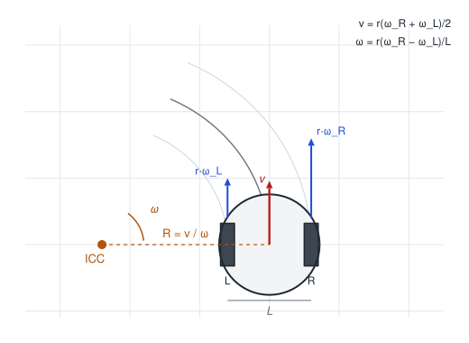

# The differential drive model

A differential drive robot steers with just two wheel speeds, and it is the
cheapest, most common platform for learning mobile robotics. This lesson derives
how wheel speeds become the robot's motion, and how integrating that motion gives
an estimate of pose — the foundation for M3's controllers and for the state
estimation of M5.

## Where you will use this

Robot vacuum cleaners, warehouse AMRs and the TurtleBot all move on two wheels, left and right. The
model of this lesson is the formula that turns ROS 2's velocity command `cmd_vel` (linear $v$,
angular $\omega$) into wheel speeds for the motors, and the odometry that turns encoder readings back
into a robot position. Localization in M5 uses this model as its "predict" step, and every command
Nav2 issues in M9 reaches the wheels through it.

## Concepts

### State and input

The pose of a robot in the plane is the three values $(x, y, \theta)$. This is
exactly the $SE(2)$ transform $T_{wr}$ from M1. The control inputs are the angular
velocities of the right and left wheels, $\omega_R$ and $\omega_L$; call the wheel
radius $r$ and the distance between the wheels (the track width) $L$.

### Wheel speeds to robot speed

The contact-point speed of each wheel is $r\omega_R$ and $r\omega_L$. The linear
velocity $v$ of the robot center is their average, and the angular velocity
$\omega$ is their difference divided by the track width. Equal wheel speeds give a
straight line, equal and opposite speeds give a turn in place, and anything in
between traces an arc of radius $R = v/\omega$.

### The unicycle model and the nonholonomic constraint

Viewed in terms of the body velocities $(v, \omega)$, a differential drive is the
same as the **unicycle model**. The wheels do not slip sideways, so the robot
cannot translate instantaneously along its own lateral direction. Because of this
**nonholonomic constraint** a three-dimensional pose has to be controlled with two
inputs, and a maneuver like "parallel park 30 cm sideways" is only possible by
combining driving and turning.

### Odometry

Measuring $\omega_R$ and $\omega_L$ with wheel encoders and integrating the
equations above over time gives an estimate of pose. This is **odometry (dead
reckoning)**. Wheel slip, errors in the radius and track width, and integration
error all keep accumulating, so over long runs the position drifts badly.
Correcting that drift is the job of the M4 sensors and the state estimation that
follows.



## Key formulas

$$v = \frac{r(\omega_R + \omega_L)}{2}, \qquad \omega = \frac{r(\omega_R - \omega_L)}{L}$$

The inverse (desired body velocity to wheel commands):

$$\omega_R = \frac{v + \omega L/2}{r}, \qquad \omega_L = \frac{v - \omega L/2}{r}$$

Unicycle kinematics and the nonholonomic constraint:

$$\dot{x} = v\cos\theta, \quad \dot{y} = v\sin\theta, \quad \dot{\theta} = \omega, \qquad
\dot{x}\sin\theta - \dot{y}\cos\theta = 0$$

Euler integration over a time step $\Delta t$ (the odometry update):

$$x_{k+1} = x_k + v\cos\theta_k\,\Delta t, \quad y_{k+1} = y_k + v\sin\theta_k\,\Delta t, \quad \theta_{k+1} = \theta_k + \omega\,\Delta t$$

## Example

Assume a robot about the size of an e-puck (example values: $r = 0.02$ m,
$L = 0.05$ m). With $\omega_R = 10$ and $\omega_L = 5$ rad/s:

- $v = 0.02 \times 15 / 2 = 0.15$ m/s
- $\omega = 0.02 \times 5 / 0.05 = 2$ rad/s
- turning radius $R = v/\omega = 0.075$ m

```python
import numpy as np

r, L, dt = 0.02, 0.05, 0.01


def wheels_to_body(wR, wL):
    return r * (wR + wL) / 2, r * (wR - wL) / L


def body_to_wheels(v, w):
    return (v + w * L / 2) / r, (v - w * L / 2) / r


def step(pose, v, w):
    x, y, th = pose
    return np.array([x + v * np.cos(th) * dt, y + v * np.sin(th) * dt, th + w * dt])


v, w = wheels_to_body(10, 5)
print(v, w, body_to_wheels(v, w))  # 0.15 2.0 (10.0, 5.0) - ignoring float error

pose = np.zeros(3)
for _ in range(int(np.pi / w / dt)):  # half a turn (pi rad)
    pose = step(pose, v, w)
print(pose.round(3))  # roughly [0, 0.15, pi]: diameter 2R = 0.15 m
```

**Exercise:** (1) drive a circle at constant wheel speeds, then a figure eight by
flipping the sign of $\omega$ over time. (2) Explain why the circle fails to close
when you raise $\Delta t$ to 0.1 s. (3) Assume the true $r$ is 2% smaller than the
model, compute the wheel speeds, and plot how the gap between the odometry
estimate and the "true" position grows over time.

```expected
1. Wheel speeds (10, 5) rad/s give $v = 0.15$ m/s and $\omega = 2$ rad/s: a circle of radius
   $v/\omega = 0.075$ m, once round in $\pi \approx 3.14$ s. Flipping the sign of $\omega$ every $\pi$ seconds
   (swapping the two wheel speeds) gives a figure eight, two circles 0.15 m across touching at a point.
2. Euler integration draws not a circle but a polygon that turns $\omega\Delta t$ per step. With
   $\Delta t = 0.1$ s that is 11.46° per step, and 360° divided by it is 31.4, not a whole number.
   After 31 steps the robot has turned 355.2° and is about 6 mm from where it started. With
   $\Delta t = 0.01$ s it turns 359.8° in 314 steps and the gap shrinks to 0.2 mm. The polygon's radius,
   $v\Delta t / (2\sin(\omega\Delta t/2)) = 0.0751$ m, is also slightly larger than the circle's.
3. With wheels 2% smaller, the same wheel speeds really give $v = 0.147$ m/s and $\omega = 1.96$ rad/s
   while odometry believes 0.15 and 2.0.

   | Time | Position difference | Heading difference |
   | --- | --- | --- |
   | 1 s | 3 mm | 2.3° |
   | 5 s | 15 mm | 11.5° |
   | 10 s | 30 mm | 22.9° |
   | 20 s | 58 mm | 45.8° |

   The heading error grows by 2.3° every second without limit. Driving straight (10 s, 1.5 m) the
   position is off by 2% of the distance, 30 mm. Nothing ever reduces the error, which is why
   odometry alone cannot be trusted for position.
```

## Self-check questions

1. How does the robot move when $\omega_R = -\omega_L$, and where is the center of rotation?
2. Why can a differential drive robot still reach any pose in the plane despite the nonholonomic constraint?
3. Give three causes of odometry error growing over time.

## How to study this stage

1. **Textbook:** read the introduction to Modern Robotics Ch. 13 and its section on differential drive kinematics (the notation differs slightly from this lesson, so tabulate the correspondence). If you have Siegwart's book, read Ch. 3 alongside it.
2. **Videos:** watch the wheeled mobile robot kinematics video from the Modern Robotics Ch. 13 lectures.
3. **This lesson plus the example:** compute the example numbers by hand, then reproduce the half-turn trajectory in code.
4. **Problems:** take the quiz in the Korean original (`rc quiz m3-differential-drive`), then do exercises (1) through (3).
5. **Optional depth:** skim the probabilistic treatment of odometry models in Probabilistic Robotics Ch. 5. It is a preview of the M4 sensor and filtering lessons.

## References

- Kevin M. Lynch, Frank C. Park, *Modern Robotics*, Ch. 13 "Wheeled Mobile Robots" —
  <http://hades.mech.northwestern.edu/index.php/Modern_Robotics>
- Modern Robotics lecture video index — <https://hades.mech.northwestern.edu/index.php/Modern_Robotics_Videos>
- Roland Siegwart, Illah R. Nourbakhsh, Davide Scaramuzza, *Introduction to Autonomous Mobile
  Robots*, 2nd ed., MIT Press, 2011 — Ch. 3 "Mobile Robot Kinematics".
- Sebastian Thrun, Wolfram Burgard, Dieter Fox, *Probabilistic Robotics*, MIT Press, 2005 —
  Ch. 5 "Robot Motion" (companion site: <https://robots.stanford.edu/probabilistic-robotics/>).
