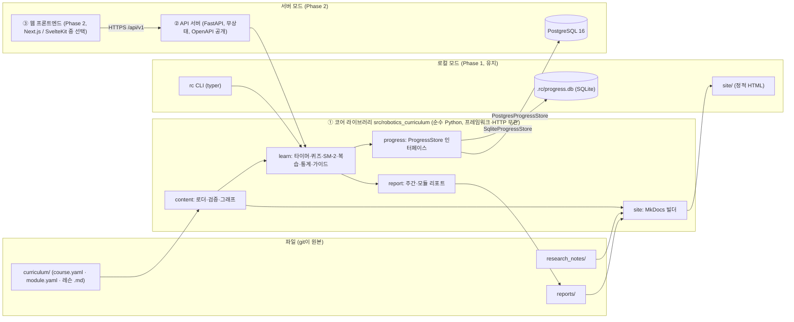
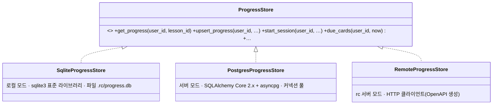
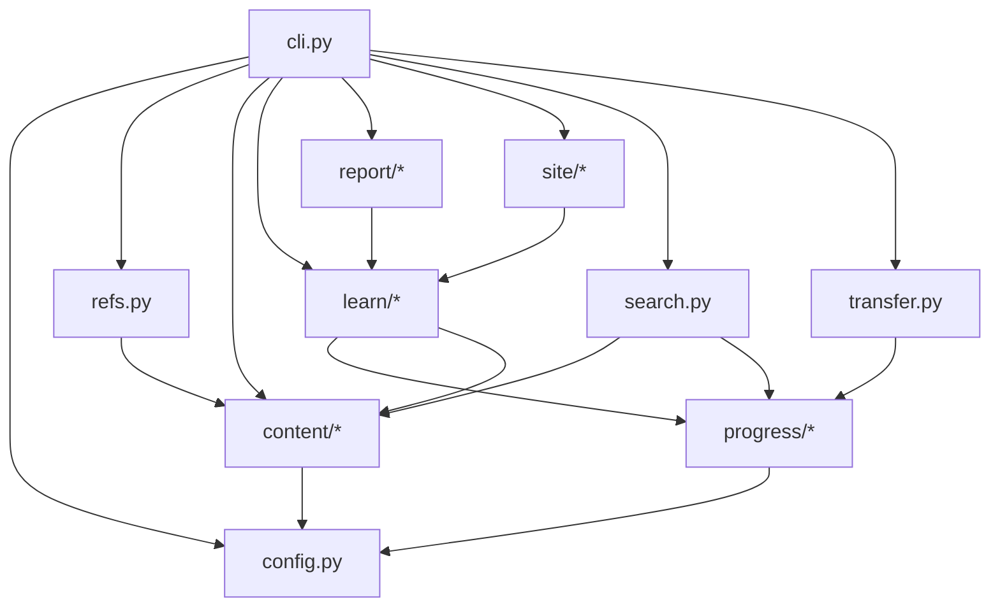

# 플랫폼 설계 문서 (Platform Design)

| 항목 | 내용 |
|---|---|
| 문서 버전 | 0.4 (Draft) |
| 작성일 | 2026-11-11 (v0.4: 오픈소스·엔터프라이즈급 결정 반영) |
| 상태 | 검토 대기 |
| 상위 문서 | `docs/PRD.md` v0.7 (91b8c2f; 기능 요구사항·비기능 수치·릴리스 계획·거버넌스는 그 문서를 따르며 여기서 반복하지 않는다) |
| 관련 결정 | `docs/adr/0001-phase1-stack.md` (Phase 1 = Python 단일 스택, 로컬 모드로 유지) |
| 하위 문서 | `docs/architecture/auth.md` (인증·권한), `docs/architecture/operations.md` (운영) |
| 콘텐츠 스키마 확정본 | `docs/curriculum/CONTENT_MODEL.md`, `src/robotics_curriculum/content/models.py`. 이 문서 §3은 요약이며 충돌 시 구현이 우선 |
| 전제 | 코어 패키지 `src/robotics_curriculum/`, CLI `rc`(typer), pydantic v2, 콘텐츠 `curriculum/`, 정적 사이트 MkDocs → `site/`, 진도 저장 `ProgressStore`(로컬 SQLite / 서버 PostgreSQL) |

**제품 한 줄 정의**: "로보틱스 전문가 코스" 하나를 위한 전용 커리큘럼 플랫폼. 기초 → 중급 → 고급 단계로 묶인 모듈을 순서대로 학습하고, 개인 진도를 기록하며, 각 단계에서 **무엇을 읽고·어떤 문제를 풀고·어떤 강의를 볼지**(학습 방법과 자료)를 바로 열람한다. 시뮬레이터 연동 같은 복잡한 기능은 범위 밖이다(사용자 결정, 2026-11-11).

**개발 방식(사용자 결정, 2026-11-11)**: 오픈소스 프로젝트로 공개하고 **엔터프라이즈급**으로 개발한다. 즉 다중 사용자·인증·권한·감사·운영(배포·관측·백업)을 처음부터 설계에 넣되, Phase 1의 `rc` CLI + 정적 사이트는 **로컬 모드**로 그대로 유지하고 그 위에 API 서버와 웹 프론트엔드를 얹는다.

이 문서의 범위.

1. 전체 구조 — 코어 라이브러리 → API 서버 → 웹 프론트엔드 3계층
2. 정보 구조(IA)와 정적 사이트·웹 앱 페이지 구조·와이어프레임, i18n·접근성
3. 콘텐츠 디렉터리·스키마 요약과 "단계별 학습 방법·자료" 확장안
4. 데이터 모델 — 진도 테이블, 계정·권한·감사 테이블, SQLite/PostgreSQL 구현과 마이그레이션
5. `rc` CLI 명령별 입출력
6. 패키지 모듈 구성과 의존 다이어그램
7. 테스트 전략 (단위·계약·보안·부하)
8. 인증·권한 요약 (→ `docs/architecture/auth.md`)
9. 운영 요약 (→ `docs/architecture/operations.md`)

---

## 1. 전체 구조 (3계층)



| 계층 | 책임 | 하지 않는 것 |
|---|---|---|
| ① 코어 라이브러리 | 콘텐츠 로드·검증, 학습 규칙(잠김, SM-2, 통계, 공부법 조립), 리포트, 사이트 빌드. `ProgressStore` 인터페이스로 저장소를 추상화 | HTTP·세션·인증·프레임워크를 모른다. 사용자 식별은 호출자가 넘기는 `user_id` 문자열뿐 |
| ② API 서버 | 인증·권한(→ §8), 요청 검증, 코어 호출, OpenAPI 스키마 공개, 감사 로그, 관측 | 비즈니스 규칙 중복 구현 금지(규칙은 코어에만). 프로세스 내 상태 없음(수평 확장) |
| ③ 웹 프론트엔드 | 화면(§2), i18n, 접근성, API 호출 | 코어 import 금지. API만 호출 |

- **콘텐츠는 파일이 원본**. 로컬 모드와 서버 모드 모두 같은 `curriculum/`을 읽는다. 서버는 시작 시 로드해 메모리에 두고 `/readyz`에서 로드 성공을 검사한다.
- **학습 데이터는 `ProgressStore`가 원본**. 로컬 모드는 SQLite 파일, 서버 모드는 PostgreSQL. `rc progress export`/`GET /api/v1/me/export`는 같은 JSON 스키마를 낸다.
- **로컬 모드는 계속 1급 시민**이다. 오픈소스 사용자가 `pipx install robotics-curriculum` 한 줄로 서버 없이 쓰는 경로를 깨지 않는다.

### 1.1 API 서버 요약

- FastAPI + pydantic v2, 비동기, `uvicorn`. 경로 접두사 `/api/v1`. 리소스: `courses`, `modules`, `lessons`, `guide`, `progress`, `sessions`, `cards`, `reviews`, `quiz`, `resources`, `reports`, `search`, `me`, `auth`, `admin`.
- **무상태**: 세션 상태는 DB(또는 Redis)에, 콘텐츠는 읽기 전용 메모리 캐시에. 레플리카 수와 무관하게 동작.
- **OpenAPI 스키마 공개**: `/openapi.json`과 `/docs`(Swagger UI)를 노출하고, `docs/api/openapi.json` 스냅샷을 저장소에 커밋해 계약 테스트(§7)와 클라이언트 생성(웹·`rc` 서버 모드)의 기준으로 삼는다. 스키마 변경은 PR에서 diff로 리뷰한다.
- 오류 형식은 RFC 9457 Problem Details(`application/problem+json`: `type`, `title`, `status`, `detail`, `instance`, `request_id`). 페이지네이션은 커서 기반. 모든 응답에 `X-Request-ID`.
- **서버 콘텐츠 색인(AC-API.6)**: 서버는 시작 시 `curriculum/`을 코어 로더로 로드·검증해 **불변 메모리 스냅샷**(코스 트리, 레슨 본문 HTML, 공부법 절, 자료 합집합, 검색 색인)을 만든다. 재색인 시점은 (1) 시작, (2) `POST /api/v1/admin/content/reload`(author 이상, 감사 로그), (3) 배포(이미지에 콘텐츠를 구워 넣으므로 새 컨테이너 = 새 색인). 재색인은 새 스냅샷을 완성한 뒤 참조를 원자적으로 교체하므로 진행 중에도 요청은 이전 색인으로 응답한다. 검증 실패 시 **이전 색인을 유지**하고 422 + 오류 목록을 돌려주며 `/readyz`는 계속 ready다(시작 시 실패는 not_ready). 목표: 레슨 1,000개 로드·검증·렌더링 60초 이내(측정은 `tests/perf/test_index.py`). 스냅샷에는 콘텐츠 커밋 SHA와 색인 시각을 붙여 `/version`·`/admin/content`에 노출한다.
- 디렉터리(PRD 9절과 동일): `api/`(패키지 `robotics_curriculum_api`, 코어에 의존하는 별도 배포 단위), `web/`(Phase 2), `deploy/`(Compose·백업 스크립트).

### 1.2 웹 프론트엔드 후보 비교 (Phase 2, 선택은 열린 항목 §10)

| 기준 | Next.js (App Router, React) | SvelteKit |
|---|---|---|
| 생태계·기여자 풀 | 가장 큼. 오픈소스 기여자 접근성 높음 | 작지만 성장 중 |
| MDX·KaTeX·Mermaid 렌더링 | `next-mdx-remote`, `rehype-katex` 등 성숙 | `mdsvex` 가능, 플러그인 수 적음 |
| SSR/SSG·캐싱 | RSC·ISR로 레슨 페이지 정적화 용이 | 어댑터 기반 SSR/프리렌더, 단순 |
| 번들 크기·런타임 성능 | 큼 | 작음(컴파일 타임) |
| i18n | `next-intl` 성숙 | `paraglide`, `svelte-i18n` |
| 접근성 도구 | `eslint-plugin-jsx-a11y`, Radix/Headless UI | `svelte-check` a11y 경고 내장, 컴포넌트 라이브러리 적음 |
| 학습 곡선 | RSC·캐싱 모델이 복잡 | 낮음 |
| 디자인 토큰 연동 | Tailwind + CSS 변수 (Figma Tokens와 1:1) | 동일 |
| 권장 | 기여자 풀과 생태계가 결정적이면 Next.js | 번들·단순성이 결정적이면 SvelteKit |

결정 전까지 웹은 **API 계약(OpenAPI)과 Figma 화면**만 확정하고 구현을 시작하지 않는다.

---

## 2. 정보 구조 (IA)

### 2.1 콘텐츠 계층과 식별자 (구현 기준)

| 계층 | 위치 | ID | 예 |
|---|---|---|---|
| Course | `curriculum/<course-dir>/course.yaml` | slug | `robotics-expert` (코스는 하나) |
| Module | `curriculum/<course-dir>/<module-dir>/module.yaml` | slug, 코스 내 유일 | `m2-kinematics` |
| Lesson | `.../<module-dir>/<lesson>.md` | slug, 코스 내 유일. 관례 `<모듈 접두어>-<주제>` | `m2-forward-kinematics` |
| Activity | 레슨 프런트매터 `activities[]` | slug, 코스 내 유일. 관례 `<lesson-id>-<kind>` | `m2-forward-kinematics-quiz` |
| Resource (제안) | `curriculum/resources/*.yaml` | slug, 저장소 전체 유일 | `lynch-park-modern-robotics` |
| 단계 | 모듈의 `level` 필드 (한글 리터럴) | `기초` · `중급` · `고급` | 기초 M1–M4, 중급 M5–M8, 고급 M9–M10 |

- CLI 인자는 전체 ID 또는 유일한 접두어를 받는다. 둘 이상 매칭되면 후보를 보여주고 종료 코드 2.
- 단계는 별도 디렉터리가 아니라 모듈 메타데이터다. 로드맵·대시보드는 `level`로 모듈을 묶어 보여준다.
- 모듈 배정(PRD v0.4 부록 A): 기초 = M1 수학·물리, M2 운동학, M3 이동 로봇·제어, M4 센서·인식 기초 / 중급 = M5 상태 추정·SLAM, M6 내비게이션·경로 계획, M7 매니퓰레이션·동작 계획, M8 ROS 2·도구 개요 / 고급 = M9 학습 기반 로보틱스, M10 시스템 통합·프로젝트.

### 2.2 정적 사이트 페이지 구조

`rc build`가 MkDocs(Material 테마)로 생성한다. 쓰기 동작은 전부 CLI에 있고 사이트는 읽기 전용이다.

```
site/
├─ index.html                      대시보드: 현재 단계·모듈·다음 레슨, 단계별 진행률, 이번 주, 복습
├─ roadmap/                        로드맵: 단계(기초/중급/고급)별로 묶인 모듈과 선수지식 그래프
├─ modules/<module>/               모듈 개요: 레슨 목록·상태, 모듈 학습 가이드, 모듈 자료
├─ modules/<module>/<lesson>/      레슨 페이지: 본문, "이 단계 공부법", 자료 목록, 퀴즈 미리보기, 노트
├─ resources/                      자료실: 유형·단계·주제 필터, 읽기 상태
├─ reports/                        reports/*.md 복사본
├─ notes/                          research_notes/ 색인 (P1)
└─ assets/                         KaTeX, Mermaid, 생성된 progress.json
```

내비게이션(좌측): 대시보드 · 로드맵 · 기초 › 모듈 › 레슨 · 중급 › … · 고급 › … · 자료실 · 리포트 · 노트.

**웹 앱 라우트 (Phase 2, 서버 모드)** — 정적 사이트와 같은 학습 라우트에 다음을 더한다. 학습 라우트는 로그인 필수, 쓰기 동작(완료·타이머·복습·노트)은 화면에서 바로 한다.

```
/login                         로그인 (이메일+비밀번호, Google · GitHub · 기관 OIDC)
/signup                        회원가입, /verify-email, /password/forgot, /password/reset
/auth/callback/{provider}      OIDC 콜백 (API가 처리 후 리다이렉트)
/profile                       프로필 · 연결된 계정 · 보안(비밀번호, 세션) · API 토큰 · 언어·테마 · 데이터(내보내기, 계정 삭제)
/admin                         관리자 홈 (admin 역할): /admin/users, /admin/content, /admin/audit, /admin/system
```

### 2.3 와이어프레임

**대시보드 `index.html`**
```
┌──────────────────────────────────────────────────────────────────────┐
│ 로보틱스 전문가 코스   대시보드 | 로드맵 | 기초 | 중급 | 고급 | 자료실  🌙 │
├──────────────────────────────────────────────────────────────────────┤
│ 빌드: 2026-11-11 21:03  (진도 반영은 `rc build` 재실행)                 │
│                                                                      │
│ 현재 위치                                                              │
│  단계  기초  ▸  모듈  M2 로봇 운동학 (1/3 레슨)  ▸  다음  m2-forward-kinematics│
│  [이 레슨 공부법 보기]   시작: rc start m2-forward-kinematics             │
│                                                                      │
│ 단계별 진행률                                                           │
│  기초 35%  M1 수학·물리 ████████ 100%  M2 운동학 ███░░░ 40%  M3 이동로봇·제어 ░░░ 0%  M4 센서·인식 ░░░ 0% │
│  중급  0%  M5 상태추정·SLAM ▨  M6 내비게이션 ▨  M7 매니퓰레이션 ▨  M8 ROS 2·도구 ▨  (잠김) │
│  고급  0%  M9 학습 기반 로보틱스 ▨  M10 시스템 통합·프로젝트 ▨  (잠김)          │
│                                                                      │
│ ┌ 이번 주 ──────────┐ ┌ 연속 학습 ─┐ ┌ 오늘 복습 ─┐ ┌ 읽는 중인 자료 ─────┐ │
│ │ 4h 35m / 5h  91%  │ │ 🔥 7일     │ │ 12장       │ │ Modern Robotics ch.4│ │
│ └───────────────────┘ └────────────┘ └────────────┘ │ 3Blue1Brown 선형대수 │ │
│                                                     └─────────────────────┘ │
│ 최근 활동                                                               │
│  11/11 m2-dh-parameters 완료 (이해도 4) · 11/10 퀴즈 m2-dh 4/5            │
└──────────────────────────────────────────────────────────────────────┘
```

**로드맵 `roadmap/`**
```
┌──────────────────────────────────────────────────────────────────────┐
│ 로드맵 — 단계별 모듈            범례: ■완료 ▣진행중 □가능 ▨잠김(선수 미완) │
│                                                                      │
│ ┌ 기초 (진행 중 35%) ───────┐ ┌ 중급 (잠김) ───────────┐ ┌ 고급 (잠김) ──────────┐│
│ │ ■ M1 수학·물리            │ │ ▨ M5 상태 추정·SLAM     │ │ ▨ M9 학습 기반 로보틱스││
│ │   m1-vectors ■ m1-rot ■   │ │ ▨ M6 내비게이션·경로 계획│ │ ▨ M10 시스템 통합·    ││
│ │ ▣ M2 운동학               │─▶ ▨ M7 매니퓰레이션·동작  │─▶     프로젝트         ││
│ │   m2-dh ■ m2-fk ▣ m2-ik ▨ │ │ ▨ M8 ROS 2·도구 개요    │ │                      ││
│ │ □ M3 이동 로봇·제어        │ │                        │ │                      ││
│ │ □ M4 센서·인식 기초        │ │                        │ │                      ││
│ └───────────────────────────┘ └────────────────────────┘ └──────────────────────┘│
│                                                                      │
│ 선수지식 그래프 (Mermaid, 노드 클릭 → 레슨)                               │
│  m1-vectors → m1-rotations → m2-dh → m2-fk → m2-ik → m7-manipulation …   │
└──────────────────────────────────────────────────────────────────────┘
```

**레슨 페이지 `modules/m2-kinematics/m2-forward-kinematics/`**
```
┌───────────────┬────────────────────────────────────────────┬───────────┐
│ ◂ 기초         │ 정기구학 (Forward Kinematics)                │ 이 페이지  │
│ M2 로봇 운동학  │ 기초 · M2 · ⏱ 40분 · 난이도 ●●●○○ · 선수: m2-dh  │ 공부법    │
│  ■ m2-dh       │ 상태: 진행 중 (활동 1/3)                      │ 자료      │
│  ▣ m2-fk       │                                            │ 1. 정의    │
│  ▨ m2-ik       │ 학습 목표                                   │ 2. 유도    │
│ M3 이동로봇·제어│  • DH 표에서 T_0^n 을 계산한다                │ 3. 예제    │
│  □ m3-diffdrive│  • 2링크 팔의 끝점 위치를 코드로 구한다        │ 퀴즈      │
│  …             │                                            │ 노트      │
│               │ ┌ 이 단계 공부법 ───────────────────────────┐ │           │
│               │ │ 1. 읽기  Modern Robotics 4.1–4.2 (60분)    │ │           │
│               │ │    └ 포인트: 공간 vs 물체 프레임 PoE 구분    │ │           │
│               │ │ 2. 보기  Lynch 강의 영상 "FK of open chains"│ │           │
│               │ │ 3. 본문  아래 1~3절 읽고 예제 손으로 재현    │ │           │
│               │ │ 4. 풀기  연습문제 MR 4.1, 4.5 + 퀴즈 3문항  │ │           │
│               │ │ 5. 쓰기  노트에 "DH vs PoE 차이" 한 단락     │ │           │
│               │ │ 완료 조건: 퀴즈 ≥ 2/3, 이해도 자기평가 ≥ 3   │ │           │
│               │ └────────────────────────────────────────────┘ │           │
│               │ ┌ 자료 ──────────────────────────────────────┐ │           │
│               │ │ 📘 Modern Robotics ch.4   교재 · 무료 · 기초 │ │           │
│               │ │ 🎞 Lynch FK 강의 (12분)   영상 · 무료        │ │           │
│               │ │ 📄 Craig ch.3             교재 · 유료 · 보조 │ │           │
│               │ │ 📝 내 노트 research_notes/…/m2-fk.md         │ │           │
│               │ └────────────────────────────────────────────┘ │           │
│               │ ## 1. 정의                                   │           │
│               │ $$ T_0^n = \prod_{i=1}^{n} A_i(\theta_i) $$  │           │
│               │ …                                            │           │
│               │ ┌ 퀴즈 (3문항) · 터미널: rc quiz m2-fk ───────┐ │           │
│               │ │ Q1. DH 변환 A_i 의 곱 순서는? (객관식)        │ │           │
│               │ └────────────────────────────────────────────┘ │           │
│               │ ◂ m2-dh-parameters            m2-inverse-kinematics ▸│       │
└───────────────┴────────────────────────────────────────────┴───────────┘
```

**모듈 페이지 `modules/m2-kinematics/`**: 모듈 요약(`summary`), 단계, 레슨 목록(상태·시간·각 레슨 공부법의 첫 줄), 모듈에 걸친 자료(소속 레슨들의 `resources` 합집합), 모듈 리포트 링크.

**자료실 `resources/`**: 표(제목·유형·단계·주제·비용·언어·읽기 상태), 상단 필터(유형·단계·주제·무료만), 각 행 클릭 → 자료가 쓰이는 레슨 목록.

**로그인 `/login`** (서버 모드)
```
┌──────────────────────────────────────────────────────────────┐
│ 로보틱스 전문가 코스                                    🌙      │
├──────────────────────────────────────────────────────────────┤
│                 ┌ 로그인 ─────────────────────────┐            │
│                 │ 이메일     [you@example.com    ] │            │
│                 │ 비밀번호   [••••••••••    표시 ] │            │
│                 │ ☐ 로그인 유지(14일)  비밀번호 찾기│            │
│                 │ [        로그인 (primary)       ] │            │
│                 │ ───────────  또는  ───────────   │            │
│                 │ [ Google 계정으로 계속          ] │            │
│                 │ [ GitHub 계정으로 계속          ] │            │
│                 │ [ 기관 계정(OIDC)으로 계속       ] │            │
│                 │ 계정이 없으신가요? 회원가입        │            │
│                 └──────────────────────────────────┘            │
│        로컬 모드(rc CLI)는 로그인 없이 동작 · 서버 모드 전용 화면   │
└──────────────────────────────────────────────────────────────┘
```

**회원가입 `/signup`**: 같은 카드 레이아웃. 이름 · 이메일 · 비밀번호(12자 이상, 규칙 도움말) · 비밀번호 확인 · 약관 동의 · [가입하고 인증 메일 받기] · "또는 외부 계정으로 가입" Google/GitHub/기관 버튼 · 로그인 링크.

**프로필 `/profile`**
```
┌───────────────┬──────────────────────────────────────────────┐
│ 프로필 ●       │ 프로필                                        │
│ 연결된 계정    │ (아바타) 이형진   [learner] [가입 2026-11-11] [이메일 인증됨]│
│ 보안          │ 표시 이름 [이형진]  이메일 [lhjin@…]  시간대 [Asia/Seoul]│
│ API 토큰      │ [저장] [취소]                                   │
│ 언어·테마      │ ┌ 연결된 계정 ─────────────────────────────┐   │
│ 데이터        │ │ 로컬 비밀번호  마지막 변경 11/01     [변경] │   │
│               │ │ Google  learner@example.com · 연결됨 [연결 해제]│   │
│               │ │ GitHub  연결되지 않음               [연결] │   │
│               │ └───────────────────────────────────────────┘   │
│               │ 언어 [한국어][English]  테마 [시스템][라이트][다크]│
│               │ ┌ 데이터와 계정 (danger) ───────────────────┐   │
│               │ │ [내 데이터 내보내기 (JSON)] [rc progress export]│   │
│               │ │ 계정 삭제는 30일 유예 후 영구 삭제  [계정 삭제…]│   │
│               │ └───────────────────────────────────────────┘   │
└───────────────┴──────────────────────────────────────────────┘
```

**관리자 `/admin/users`** (admin 역할)
```
┌───────────────┬──────────────────────────────────────────────┐
│ 관리자         │ 사용자 관리                    [초대 메일 보내기]│
│ 사용자 ●       │ ┌전체 128┐┌7일 활성 64┐┌역할 120/6/2┐┌콘텐츠 1·6·25┐│
│ 콘텐츠         │ [역할▾][상태▾][가입일▾]            [🔍 검색…] │
│ 감사 로그      │ 이메일        이름   역할        상태  가입일 마지막 동작│
│ 시스템 상태    │ lhjin@…       이형진 admin learner 활성 11/01 11/11 [편집]│
│ 설정          │ author1@univ… 김교수 author       활성 11/03 11/10 [편집]│
│               │ old@…         이탈   learner      비활성 10/20 10/25 [편집]│
│               │ pending@…     신규   learner      미인증 11/11  —   [편집]│
│               │ 128명 중 1–5 · 역할 변경·비활성화는 감사 로그 기록  ‹ 1 2 3 ›│
└───────────────┴──────────────────────────────────────────────┘
```
`/admin/content`: 코스·모듈·레슨 수, 마지막 `rc validate` 결과, 콘텐츠 커밋 SHA, [사이트 재빌드] 버튼(author 이상). `/admin/audit`: 시각·행위자·동작·대상·요청 ID 표와 필터. `/admin/system`: `/readyz` 항목별 상태, 버전, 마스킹된 설정.

### 2.4 Figma

Figma 파일은 위 네 화면(대시보드·로드맵·레슨·자료실)을 데스크톱 1440 기준으로 옮긴다. 페이지 구성 `00 Cover · 01 Tokens · 02 Components(모듈 카드, 레슨 행, 공부법 스텝, 자료 행, 진행률 바) · 03 Dashboard · 04 Roadmap · 05 Lesson · 06 Resources`.

- 파일: https://www.figma.com/design/BVk1OeYnq1gFHz4etJi1oN/ (파일 키 `BVk1OeYnq1gFHz4etJi1oN`, 2026-11-11). 페이지 구성은 위 7페이지 그대로다.
- 작업 상태: 2026-11-11 Figma MCP(`use_figma`)로 작성 완료. 글꼴 Noto Sans KR(본문)·JetBrains Mono(ID·명령). 색상은 로컬 변수 컬렉션 `Tokens`(22개, 모드 Light·Dark)에 바인딩되어 프레임의 컬렉션 모드만 바꾸면 다크 모드로 전환된다. 화면 데이터는 `curriculum/robotics-expert`(기초 M1–M4 14개, 중급 M8 5개·M5 6개, 코스 순서 M1→M2→M3→M4→M8→M5)와 정기구학 레슨 본문을 그대로 썼다.

| 페이지 | 프레임 | 링크 |
|---|---|---|
| 00 Cover | Cover / 1440 — 제품 정의, 페이지 구성, 토큰 스와치 | https://www.figma.com/design/BVk1OeYnq1gFHz4etJi1oN/?node-id=12-107 |
| 01 Tokens | Tokens / Light & Dark — 변수별 Light·Dark 값과 scopes 표 | https://www.figma.com/design/BVk1OeYnq1gFHz4etJi1oN/?node-id=20-139 |
| 02 Components | 섹션 "Components": Status Dot(4) · Chip(5) · Button(3) · Nav Tab(2) · Progress Bar · Stat Tile · Module Card · Lesson Row · Study Step · Resource Row | https://www.figma.com/design/BVk1OeYnq1gFHz4etJi1oN/?node-id=20-138 |
| 03 Dashboard | Dashboard / 1440 (Light) — 현재 위치, 단계별 진행률, 스탯 타일, 최근 활동; 아래에 Dashboard / 1440 / Dark | https://www.figma.com/design/BVk1OeYnq1gFHz4etJi1oN/?node-id=11-2 |
| 04 Roadmap | Roadmap / 1440 — 기초(M1–M4)·중급(M8·M5, M6·M7 예정)·고급(M9–M10) 열, 모듈 카드, 선수지식 체인 | https://www.figma.com/design/BVk1OeYnq1gFHz4etJi1oN/?node-id=11-119 |
| 05 Lesson | Lesson / 1440 — m2-forward-kinematics: 사이드바, 학습 목표, "이 단계 공부법", 자료, 본문, 자가 점검, 우측 목차 | https://www.figma.com/design/BVk1OeYnq1gFHz4etJi1oN/?node-id=11-307 |
| 06 Resources | Resources / 1440 — 필터 바, 자료 표(제목·유형·단계·주제·비용·언어·읽기 상태) | https://www.figma.com/design/BVk1OeYnq1gFHz4etJi1oN/?node-id=11-492 |
| 07 Auth & Admin | Login / 1440 — 이메일·비밀번호, Google·GitHub·기관 OIDC | https://www.figma.com/design/BVk1OeYnq1gFHz4etJi1oN/?node-id=23-3 |
| 07 Auth & Admin | Signup / 1440 — 가입 폼, 비밀번호 규칙, 외부 계정 가입 | https://www.figma.com/design/BVk1OeYnq1gFHz4etJi1oN/?node-id=23-55 |
| 07 Auth & Admin | Profile / 1440 — 프로필, 연결된 계정, 언어·테마, 데이터 내보내기·계정 삭제 | https://www.figma.com/design/BVk1OeYnq1gFHz4etJi1oN/?node-id=23-111 |
| 07 Auth & Admin | Admin / 1440 — 사용자 관리(통계, 필터, 사용자 표, 페이지네이션), 좌측 관리자 메뉴 | https://www.figma.com/design/BVk1OeYnq1gFHz4etJi1oN/?node-id=23-221 |

알려진 제약: Figma 플러그인 API에서 인스턴스 내부 자식 크기 변경이 적용되지 않아 화면의 진행률 바는 인스턴스를 분리(detach)한 일반 프레임이다. 로드맵의 잠김 판정은 레슨 `prerequisites` 기준이므로 선수지식이 없는 M8 첫 레슨은 기초 미완료여도 "가능"으로 표시한다(구현과 동일). 파일 안의 옛 페이지 "01 Screens"에는 사용자가 붙여 넣은 URL 텍스트만 남아 있다.

### 2.5 i18n과 접근성

**i18n (ko/en)**
- UI 문자열은 전부 메시지 카탈로그(`ko`, `en`)에서 온다. 기본 언어 `ko`, 사용자 설정(`users.locale`) → 브라우저 `Accept-Language` → 기본 순으로 결정. 로컬 모드 CLI는 `RC_LANG` 환경 변수.
- 콘텐츠(레슨 본문)는 i18n 대상이 아니다. 한국어 본문에 영어 용어를 병기하는 콘텐츠 규칙은 CONTENT_MODEL.md를 따른다. 영어 콘텐츠가 생기면 `curriculum/<course>/<module>/<lesson>.en.md` 형태를 제안(열린 항목).
- 날짜·숫자·시간대는 `users.timezone`과 locale로 서식화. ISO 주 계산은 서버(코어)에서 한다.
- 디자인: 텍스트 폭이 1.5배까지 늘어나도 깨지지 않는 레이아웃(버튼·칩은 HUG, 표는 줄바꿈 허용).

**접근성 (WCAG 2.1 AA)**
- 색 대비: 본문 4.5:1, 큰 글자·UI 경계 3:1. Figma 토큰(`text/muted` #6B7280 on #FFFFFF = 4.83:1, Dark `text/muted` #9AA3AE on #171A1F = 7.1:1)으로 검증. 상태는 색만으로 전달하지 않는다(점+글자, 🔒 아이콘).
- 키보드: 모든 동작이 키보드로 가능, 포커스 링 가시(2px accent), 건너뛰기 링크, 모달 포커스 트랩.
- 구조: 랜드마크(`header/nav/main/aside`), 헤딩 계층, 표에 `th scope`, 진행률 바는 `role=progressbar aria-valuenow`, 아이콘 버튼에 `aria-label`.
- 모션·확대: `prefers-reduced-motion` 존중, 200% 확대에서 가로 스크롤 없음, 글꼴 크기 rem 단위.
- 자동 검사: axe-core(Playwright) CI, Lighthouse 접근성 90 이상 게이트; 수동 검사: 스크린 리더(NVDA·VoiceOver) 체크리스트를 릴리스마다 수행.

---

## 3. 콘텐츠 디렉터리·스키마

> 확정본은 `docs/curriculum/CONTENT_MODEL.md`. 아래 "구현" 표시는 현재 구현과 같고, "제안(미구현)"은 이 문서가 추가를 제안하는 확장이다. 프런트매터에 정의되지 않은 키는 에러이므로, 제안 필드는 모델에 추가되기 전에는 쓸 수 없다.

### 3.1 디렉터리 (구현)

```
curriculum/
├─ robotics-expert/                 # 코스 하나 = 디렉터리 하나
│  ├─ course.yaml
│  ├─ m1-math-physics/
│  │  ├─ module.yaml
│  │  ├─ m1-vectors-matrices.md
│  │  └─ m1-rotations.md
│  ├─ m2-kinematics/
│  ├─ m3-mobile-control/
│  ├─ m4-sensing-basics/
│  └─ … (m5-state-estimation-slam … m10-integration-project)
└─ resources/                       # 제안(미구현): 자료 카탈로그
   ├─ foundations.yaml
   ├─ ros2.yaml
   └─ …
```

### 3.2 `course.yaml` / `module.yaml`

```yaml
# course.yaml (구현)
id: robotics-expert
title: 로보틱스 전문가 코스
summary: 기초 수학부터 SLAM·ROS 2·캡스톤까지 단계별로 완주하는 단일 코스
tags: [robotics]
modules: [m1-math-physics, m2-kinematics, m3-mobile-control, m4-sensing-basics,
          m5-state-estimation-slam, m6-navigation-planning, m7-manipulation-planning, m8-ros2-tools,
          m9-learning-robotics, m10-integration-project]
```

```yaml
# module.yaml
id: m2-kinematics                      # 구현
title: 로봇 운동학                      # 구현
summary: DH 파라미터부터 역기구학까지     # 구현
lessons: [m2-dh-parameters, m2-forward-kinematics, m2-inverse-kinematics]   # 구현
level: 기초                             # 반영 중: 기초 | 중급 | 고급 (한글 리터럴)
```

모듈 단위 선수지식·학습 가이드 필드는 도입하지 않는다. 모듈 간 순서는 `course.modules`와 레슨 `prerequisites`로 충분하다.

### 3.3 레슨 프런트매터

```yaml
---
id: m2-forward-kinematics             # 구현
title: 정기구학                        # 구현
summary: DH 표에서 엔드이펙터 자세를 계산한다            # 구현
objectives:                           # 구현 (1개 이상)
  - DH 표에서 T_0^n 을 계산한다
  - 2링크 팔의 끝점 위치를 코드로 구한다
prerequisites: [m2-dh-parameters]     # 구현 (레슨 ID)
difficulty: 3                         # 구현 (1~5)
estimated_minutes: 40                 # 구현
tags: [기구학, DH]                     # 구현
activities:                           # 구현: id, kind(reading|quiz|exercise), title, estimated_minutes
  - { id: m2-forward-kinematics-reading, kind: reading, title: 본문 읽기, estimated_minutes: 30 }
  - { id: m2-forward-kinematics-quiz, kind: quiz, title: 정기구학 계산 퀴즈, estimated_minutes: 15 }
  - { id: m2-forward-kinematics-exercise, kind: exercise, title: 2-link / 3-link 팔 정기구학 함수 구현, estimated_minutes: 30 }
resources:                            # 구현(PRD 결정 8): 레슨 인라인 자료 목록. title 필수, url·kind·note 선택
  - { title: "Modern Robotics, 4장 Forward Kinematics (Lynch & Park)", url: "http://modernrobotics.org", kind: book, note: "PoE 정기구학" }
  - { title: "Modern Robotics 강의 영상 (4장)", url: "https://hades.mech.northwestern.edu/index.php/Modern_Robotics_Videos", kind: video }
  - { title: "Robot Modeling and Control, 2nd ed. (Spong 외)", kind: book, note: "3장 DH 기반 정기구학 예제" }
---

## 이 단계 공부법                      <!-- 본문 절. 사이트·rc show 가 이 절을 그대로 보여준다 -->

1. **읽기** Modern Robotics 4.1–4.2 (60분) — 공간 프레임 PoE와 물체 프레임 PoE 구분에 집중
2. **보기** Lynch 강의 영상 "FK of open chains" (12분)
3. **본문** 아래 1~3절을 읽고 예제를 손으로 재현 (25분)
4. **풀기** MR 연습문제 4.1, 4.5 + 퀴즈 3문항 (30분)
5. **쓰기** 노트에 "DH vs PoE 차이" 한 단락

완료 조건: 퀴즈 2/3 이상, 이해도 자기평가 3 이상

## 1. 정의
…
```

- "이 단계 공부법"은 프런트매터 필드가 아니라 **본문의 `## 이 단계 공부법` 절**이다. 작성자는 무엇을 읽고·보고·풀고·쓸지를 번호 목록으로 적고, 마지막 줄에 완료 조건을 둔다. 구조화된 `study_plan` 필드, `concepts` 필드, 활동 `kind: external`은 당장 도입하지 않는다(필요해지면 이 절을 파싱해 옮긴다).
- `resources[]`는 레슨 인라인 객체(`title`, `url?`, `kind?: book|course|video|article|other`, `note?`)다. 사이트의 자료 카드, `rc show <lesson>`, `rc resources`가 여기서 나온다. 코스 전체 자료실은 모든 레슨의 `resources[]`를 모아 보여 준다(제목 기준 중복 제거).
- 활동 `kind`는 `reading | quiz | exercise`(PRD FR-1.3). `ActivityKind.LAB`이 아직 모델에 남아 있다면 deprecated로 표시하고 제거한다(콘텐츠 모델 담당에게 요청).

### 3.4 본문 안의 퀴즈 블록 (PRD 부록 C.1 형식, P1-2 구현 중)

레슨 Markdown 안의 `quiz` 펜스 블록(내부 YAML mapping)으로 정의한다(FR-4.1). 정본은 PRD 부록 C.1과 `docs/curriculum/CONTENT_MODEL.md`(백엔드 개발자가 기록). 사이트에서는 문항·선택지만 보이고 정답·해설은 숨긴다.

````markdown
```quiz
activity: m2-forward-kinematics-quiz     # 선택: kind=quiz 활동 id. 생략하면 레슨의 첫 quiz 활동
questions:
  - id: q1
    type: single                         # single | multiple | truefalse | short
    prompt: "DH 변환 A_i 를 이루는 기본 변환의 곱 순서는?"
    choices: ["Rot_x·Trans_x·Trans_z·Rot_z", "Rot_z·Trans_z·Trans_x·Rot_x", "Trans_z·Rot_z·Rot_x·Trans_x"]
    answer: 1                            # single: 0-based 인덱스; multiple: 인덱스 리스트; truefalse: bool; short: 허용 답 문자열 리스트
    explanation: "관절축(z) 기준 회전·이동 뒤 링크축(x) 기준 이동·회전."   # 필수
    concept: { front: "DH 변환 A_i 의 기본 변환 순서는?", back: "Rot_z(θ)·Trans_z(d)·Trans_x(a)·Rot_x(α)" }   # 선택: 개념 카드
    tags: [DH, 변환]                      # 선택
```
````

- 옛 형식(bare list, `type: multi`, `card: true`)은 별칭으로 읽히되 새 콘텐츠에는 쓰지 않는다. `card: true`는 `concept`로 대체됐다.
- 플래시카드 원천: 오답 문항은 `cards(source=quiz)`, `concept`가 있는 문항은 정답 여부와 무관하게 `cards(source=concept)`.

### 3.5 자료 카탈로그 `resources/*.yaml` (Phase 2 제안, 미구현 — PRD FR-6.6)

현재 모델은 §3.3의 레슨 인라인 `resources[]`다. 아래 카탈로그는 자료가 수백 건으로 늘어 중복·메타데이터 관리가 필요해질 때 도입하는 Phase 2 제안이며, 리서치 세션이 같은 스키마로 조사 결과를 정리하고 있다. 도입 시 레슨 `resources[]` 항목에 `ref: <카탈로그 id>`를 추가해 두 방식을 병행한다.

```yaml
- id: lynch-park-modern-robotics      # kebab-case, 저장소 전체 유일
  type: book            # book | video_series | course | docs | repo | paper | article | hardware | dataset_model | community | competition_curriculum
  title: Modern Robotics: Mechanics, Planning, and Control
  author: Kevin Lynch, Frank Park
  url: http://modernrobotics.org
  language: en          # ko | en | other  (다국어는 extra.languages)
  cost: { kind: free }  # kind: free | paid, amount, currency (원문 가격은 extra.cost_note)
  level: intermediate   # beginner | intermediate | advanced (자료 난이도. 모듈 단계 기초/중급/고급과 1:1 대응해 필터에 씀)
  prerequisites: []
  topics: [기구학, 동역학, 제어]
  est_hours: 80
  last_updated: 2019
  status: active        # active | stale | discontinued | unverified
  license: CC BY-NC-SA
  quality_signal: "교과서 표준, 강의 영상·연습문제 공개"
  notes: "수식 밀도 높음. M2 전에 2~3장 먼저."
  source_checked_date: 2026-11-11
  extra: { isbn: "9781107156302", edition: 1, korean_edition: false }
```

읽기 상태(미독/읽는 중/완료)는 콘텐츠가 아니라 진도 DB(`resource_status`)에 두며, 이것도 Phase 2 제안(PRD 결정 8)이다.

### 3.6 검증 (구현 + 제안)

구현된 규칙은 CONTENT_MODEL.md 참조. 추가 규칙: `level`이 `기초|중급|고급` 중 하나(E), `resources[]` 각 항목에 `title`이 있고 `kind`가 enum 안(E), 본문에 `## 이 단계 공부법` 절이 없으면 경고(W), `quiz` 블록 YAML 파싱·문항 `id` 유일·`answer` 범위·`explanation` 존재·`activity`가 레슨의 quiz 활동 id(E).

---

## 4. 데이터 모델 — 진도 · 계정 · 저장소 구현

> 구현(integration): `src/robotics_curriculum/progress/store.py`의 `ProgressStore`(typing.Protocol) + `SqliteProgressStore`(stdlib `sqlite3`, 파일 `.rc/progress.db`, `MIGRATIONS` 딕셔너리로 스키마 버전 관리), `models.py`(`LessonProgress`, `Session`, `ProgressExport`), `service.py`(`ProgressService`). 모든 테이블에 정수 `user_id`(로컬 모드 기본 1)를 둔다. 서버 모드의 `users.id`도 정수다(§4.4).

### 4.1 기본 테이블 (구현됨, 스키마 버전 1)

```sql
lesson_progress(user_id INTEGER DEFAULT 1, lesson_id TEXT, status TEXT, started_at, completed_at,
                total_seconds INTEGER, understanding INTEGER(1..5), note TEXT,
                PRIMARY KEY(user_id, lesson_id))
  -- status: not_started | in_progress | done
sessions(id PK, user_id INTEGER, lesson_id TEXT, started_at, ended_at, note, source)
  -- source: timer | manual ; 사용자당 열린 세션(ended_at IS NULL)은 유일 인덱스로 1개
meta(key PK, value)   -- schema_version
```

`ProgressStore` 메서드: `transaction()`, `get_lesson`, `save_lesson`, `list_lessons`, `open_session`, `add_session`, `close_session`, `delete_session`, `list_sessions`, `is_empty`, `clear`, `close`. 서버 모드 구현체도 이 Protocol을 그대로 만족해야 한다(§4.5).

### 4.2 확장 테이블 (스키마 버전 2, P1-2 구현 중 — 확정본은 `docs/specs/P1-2.md`)

```sql
activity_progress(user_id, activity_id, status, updated_at, PRIMARY KEY(user_id, activity_id))
  -- 레슨 상태는 활동에서 파생: 모든 활동 done → 레슨 done, 하나라도 in_progress/done → in_progress
quiz_runs(id PK, user_id, lesson_id, activity_id, started_at, finished_at, correct, total, seconds)
quiz_attempts(id PK, run_id FK quiz_runs, user_id, lesson_id, question_id, answered_at, answer, correct)
cards(id PK, user_id, lesson_id, front, back, source, created_at, suspended)
  -- id: "<lesson_id>-concept-<qid>" | "<lesson_id>-quiz-<qid>" ; source: concept | quiz
card_state(card_id PK, user_id, repetitions, interval_days, ease, due)        -- SM-2
reviews(id PK, card_id, user_id, reviewed_at, rating, interval_before, interval_after, ease_after)
resource_status(user_id, resource_id, status, summary, updated_at, PRIMARY KEY(user_id, resource_id))
  -- status: unread | reading | done (FR-6.3)
notes(lesson_id PK, path, updated_at)                                          -- research_notes/ 색인
reports(id PK, user_id, kind, period, path, generated_at)                      -- kind: weekly | module
```

pydantic 모델은 테이블과 1:1(`Progress`, `Session`, `Card`, `CardState`, `Review`, `QuizAttempt`, `ResourceStatus`, `Note`, `Report`)로 `progress/models.py`에 둔다. 학습 테이블은 콘텐츠에 FK를 걸지 않는다(콘텐츠 ID 문자열만 보관).

### 4.3 파생 규칙

| 파생값 | 계산 |
|---|---|
| 레슨 잠김 | 선수 레슨 중 `done`이 아닌 것이 있으면 잠김(강제 열기 가능, FR-2.2) |
| 모듈 진행률 | `done` 레슨 수 / 레슨 수 |
| 단계 진행률 | 해당 `level` 모듈들의 레슨 기준 합산 |
| 현재 단계·모듈 | `in_progress` 레슨이 있으면 그 모듈, 없으면 `rc next`가 고른 레슨의 모듈 |
| 주간 학습 시간 | `sessions.minutes` 합 (ISO 주, 월요일 시작) |
| 연속 학습일 | `sessions` 또는 `lesson_progress.updated_at`이 있는 날짜의 연속 길이 |
| 오늘 복습 수 | `card_state.due <= now` 이고 `suspended = 0` |

### 4.4 계정·권한·감사 테이블 (서버 모드)

```sql
users(id PK INTEGER, email UNIQUE, email_verified_at, display_name, locale, timezone,
      password_hash NULL, role TEXT,              -- learner | author | admin (단일, 상위 역할이 하위 권한 포함)
      mfa_enabled, mfa_secret_enc NULL, status, created_at, updated_at, deleted_at NULL)
identities(id PK, user_id FK, provider, subject, email, raw_claims_json, linked_at, UNIQUE(provider, subject))
  -- PRD 8절의 User.oidc_issuer+subject 를 1:N 으로 일반화(로컬 계정 + 여러 OIDC 제공자 연결)
sessions_auth(id PK, user_id FK, created_at, last_seen_at, expires_at, ip, user_agent, revoked_at NULL)
api_tokens(id PK, user_id FK, name, token_hash UNIQUE, scopes_json, expires_at, last_used_at, revoked_at NULL)
one_time_tokens(id PK, user_id FK, kind, token_hash UNIQUE, expires_at, used_at NULL)
audit_log(id PK bigint, at, actor_user_id NULL, actor_ip, action, target_type, target_id, detail_json, request_id)
  -- PRD AuditLog(id, actor_user_id, action, target, at, ip) + detail_json, request_id
```

- 학습 테이블(§4.1–4.2)은 서버 모드 마이그레이션에서 `users`에 FK를 건다. 로컬 모드는 `users` 테이블 없이 `user_id=1`을 쓴다(현재 구현 유지).
- 사용자별 진도 분리는 저장소 계층에서 강제한다: `ProgressStore`의 모든 메서드는 첫 인자로 `user_id`를 받고, API는 인증 컨텍스트의 값만 넘긴다(§8).
- 상세(인덱스, 보존 정책, 감사 이벤트 목록)는 `docs/architecture/auth.md` §4.

### 4.5 저장소 구현과 마이그레이션



| 결정 | 선택 | 근거 |
|---|---|---|
| PostgreSQL 접근 | **SQLAlchemy Core 2.x**(ORM 아님) + `asyncpg` 드라이버 | 테이블 정의를 한 곳(`progress/schema.py`)에 두고 Alembic이 같은 메타데이터로 마이그레이션을 만든다. 쿼리는 SQL에 가깝게 유지해 SQLite 구현과 대조가 쉽다 |
| 마이그레이션 | 서버 모드는 **Alembic**(롤백 가능, `downgrade` 필수 작성). 로컬 SQLite는 현재 구현의 `MIGRATIONS` 딕셔너리(버전 번호 순 적용)를 유지하고, 두 이력의 스키마 버전 번호를 1:1로 맞춘다 | 로컬 모드에 Alembic 의존성을 더하지 않는다. 서버 리비전 `0001`은 SQLite 버전 1과 같은 테이블을 만든다 |
| 테스트 | 같은 계약 테스트 스위트를 SQLite와 PostgreSQL(testcontainers) 양쪽에 돌린다 | 구현체 간 동작 차이를 CI에서 잡는다 |
| 트랜잭션 | 저장소 메서드 단위. 복합 동작(레슨 완료 → 카드 생성)은 `service.py`가 한 트랜잭션으로 묶는다 | |
| ID | `user_id`는 양쪽 모두 정수 (`users.id` = PostgreSQL identity) | 현재 구현(INTEGER)과 PRD 엔티티를 그대로 따른다. 외부 노출용 불투명 ID가 필요해지면 `users.public_id`(uuid)를 추가 |

마이그레이션 원칙: expand → migrate → contract(§9). `/readyz`는 리비전이 `head`인지 검사한다.

---

## 5. `rc` CLI 설계

### 5.1 공통 규약

- 참조 인자(`<lesson>`, `<module>`, `<resource>`)는 전체 ID 또는 유일 접두어.
- 텍스트 출력이 기본, `--json`이면 JSON 한 덩어리. 에러·경고는 stderr.
- 종료 코드: `0` 성공, `1` 검증 실패, `2` 사용 오류(모호한 참조, 잘못된 인자).
- 전역 옵션: `--root <dir>`(기본: cwd에서 위로 `curriculum/` 탐색), `--db <path>`, `--user <id>`, `--json`, `-q`.
- 설정 `.rc/config.toml`(저장소 루트, git 무시):

```toml
[paths]
db = ".rc/progress.db"
site = "site"
notes = "research_notes"

[goals]
weekly_minutes = 300
```

### 5.2 명령 목록

| 명령 | 인자·옵션 | 읽음 | 씀 | 출력 요지 |
|---|---|---|---|---|
| `rc validate [path]` | `--strict` | `curriculum/` | 없음 | `파일경로: 메시지` 목록, `OK: N lessons in M modules` |
| `rc build` | `--out site/`, `--serve`, `--no-progress` | 콘텐츠, DB, `research_notes/`, `reports/` | `build/mkdocs/`, `site/` | 생성 페이지 수 |
| `rc status [module\|lesson]` | `--week` | 콘텐츠, DB | 없음 | 현재 단계·모듈·다음 레슨, 단계별 진행률 |
| `rc next` | `-n <k>` | 콘텐츠, DB | 없음 | 추천 레슨 + 이유 + 공부법 첫 줄 |
| `rc show <lesson>` (구현) | | 콘텐츠 | 없음 | 레슨 메타(단계·모듈·시간·난이도·선수), 학습 목표, "이 단계 공부법" 절, `resources[]` |
| `rc resources <lesson>` / `--module <id>` / `--all` (구현) | | 콘텐츠 | 없음 | 자료 목록(제목·종류·링크·메모), 모듈·코스 단위는 중복 제거 |
| `rc roadmap` (구현) | `--json` | 콘텐츠, DB | 없음 | 단계별 모듈·레슨 상태 트리 |
| `rc start <lesson>` | | DB | `sessions`, `lesson_progress` | 시작 시각 |
| `rc stop` | `--discard` | DB | `sessions` | 경과 시간 |
| `rc log <duration> [lesson]` | `--on <date>` | DB | `sessions` | 기록된 분 |
| `rc done <lesson>` | `-u <1-5>`, `-m "<메모>"`, `--undo` | 콘텐츠, DB | `lesson_progress`, `cards` | 상태, 해금된 레슨 |
| `rc quiz <lesson>` | `--only <qid,…>`, `--retry-wrong` | 콘텐츠, DB | `quiz_attempts`, `cards` | 문항별 채점, 점수 |
| `rc review` | `-n <k>`, `--lesson <id>`, `--dry-run` | DB | `reviews`, `card_state` | 카드 제시, 요약 |
| `rc note <lesson>` | `--print` | 콘텐츠 | `research_notes/<module>/<lesson>.md`, `notes` | `$EDITOR`로 연 뒤 경로 |
| `rc read <자료> --status reading\|done` (Phase 2 제안) | | 콘텐츠 | `resource_status` | 자료 읽기 상태 변경 |
| `rc report weekly [YYYY-Www]` | `--open` | DB, 콘텐츠 | `reports/YYYY-Www.md`, `reports` | 파일 경로 |
| `rc report module <module>` | | DB, 콘텐츠 | `reports/module-<id>.md`, `reports` | 파일 경로 |
| `rc search <query>` | `--in lessons\|notes\|resources\|cards`, `-n` | 콘텐츠, 노트 | 없음 | 매치 목록 |
| `rc progress export [file]` (구현) | | DB | JSON(`ProgressExport`: schema_version, exported_at, lesson_progress[], sessions[]) | 레코드 수 |
| `rc progress import <file>` (구현) | `--merge\|--replace`, `--dry-run` | 파일 | 학습 테이블 | 반영 수, 충돌 |
| `rc version` | | | | 버전 |

### 5.3 명령별 상세

**`rc status`**
```
$ rc status
로보틱스 전문가 코스   전체 31%   이번 주 4h 35m / 5h   연속 7일   오늘 복습 12장
현재: 기초 › M2 로봇 운동학 (1/3) › 다음 m2-forward-kinematics
  기초   ███░░░░░  35%   M1 ■ 100%   M2 ▣ 40%   M3 □ 0%   M4 □ 0%
  중급   ░░░░░░░░   0%   M5 ▨  M6 ▨  M7 ▨  M8 ▨   (선수 미완료)
  고급   ░░░░░░░░   0%   M9 ▨  M10 ▨
공부법: rc show m2-forward-kinematics   시작: rc start m2-forward-kinematics
```

**`rc next`** — 선수지식 충족 ∧ 미완료 레슨 중 `course.modules → module.lessons` 순으로 가장 앞선 것. `in_progress`가 있으면 그것이 1순위.
```
$ rc next
▶ m2-forward-kinematics  정기구학  (기초 · M2 · 40분 · 난이도 3)
  이유: 진행 중 · 남은 활동: quiz, exercise
  공부법 1단계: 읽기 Modern Robotics 4.1–4.2 (60분)  → 전체: rc show m2-forward-kinematics
```

**`rc show`** (구현) — 레슨 메타, 학습 목표, 본문의 `## 이 단계 공부법` 절, `resources[]`를 출력. `rc resources`는 자료 부분만 레슨·모듈·코스 단위로.
```
$ rc show m2-forward-kinematics
정기구학 — 이 단계 공부법
 1. 읽기  Modern Robotics 4.1–4.2 (60분) — 공간 프레임 PoE와 물체 프레임 PoE 구분에 집중
 2. 보기  Lynch 강의 영상 "FK of open chains" (12분)
 3. 본문  아래 1~3절을 읽고 예제를 손으로 재현 (25분)
 4. 풀기  MR 연습문제 4.1, 4.5 + 퀴즈 3문항 (30분)
 5. 쓰기  노트에 "DH vs PoE 차이" 한 단락
완료 조건: 퀴즈 2/3 이상, 이해도 자기평가 3 이상
자료
 📘 Modern Robotics ch.4   book · free · 기초 · 읽는 중   http://modernrobotics.org
 🎞 Lynch FK 강의           video_series · free
 📄 Craig ch.3              book · paid · 보조
```

**`rc start / stop / log`** — `start`는 열린 세션이 있으면 거부(종료 코드 2). 레슨이 `not_started`면 `in_progress`로. `stop`은 분 단위 반올림(최소 1분), `--discard`는 삭제. `log 45m` / `1h30m` / `90`.

**`rc done`**
```
$ rc done m2-forward-kinematics -u 4 -m "자코비안은 아직 감이 없음"
✔ 정기구학 완료  이해도 4
  해금: m2-inverse-kinematics
```
`--undo`는 `in_progress`로 되돌린다. 플래시카드는 당분간 퀴즈 오답(§`rc quiz`)에서만 생긴다.

**`rc quiz <lesson>`** — 레슨의 `quiz` 블록 문항을 순서대로 묻고 즉시 채점. `single` 인덱스 일치, `multiple` 집합 일치, `truefalse` bool, `short` 정규화(trim·소문자·공백 축약) 후 허용 답 중 하나. 한 번의 실행이 `quiz_runs` 1행(정답 수·총 문항·소요 초)과 문항별 `quiz_attempts`가 되고, 오답은 `cards(source=quiz)`, `concept`가 있는 문항은 `cards(source=concept)`로 등록(이미 있으면 유지). 모든 문항에 답하면 해당 quiz 활동을 `activity_progress`에 `done`으로 기록한다(점수와 무관). 종료 출력 `결과 2/3 (67%)  오답 1 → 카드 2장(오답 1 + 개념 1)`. `--retry-wrong`은 직전 실행의 오답만 다시 낸다.

**`rc review` (SM-2)** — due 카드를 하나씩: 앞면 → Enter → 뒷면 → `1 again · 2 hard · 3 good · 4 easy`. 계산(`learn/sm2.py`, 순수 함수, 단위 테스트 필수), q = again 1 / hard 3 / good 4 / easy 5:
```
if q < 3: repetitions = 0; interval = 1
else:
    repetitions += 1
    interval = 1 if repetitions == 1 else 6 if repetitions == 2 else round(interval * ease)
ease = max(1.3, ease + (0.1 - (5 - q) * (0.08 + (5 - q) * 0.02)))
due = today + interval days
```
같은 세션의 `again` 카드는 세션 끝에 다시(최대 2회).

**`rc report weekly`** — 템플릿 `report/templates/weekly.md.j2`: 요약(학습 시간·세션·연속일, 완료 레슨·퀴즈 정답률, 복습 수), 완료 레슨 표(이해도·시간·메모), 막힌 지점(again 2회 이상 카드, 메모), 다음 주 제안(`rc next` 결과와 그 공부법 첫 스텝). `rc report module`은 모듈 레슨별 상태·이해도 분포·자료 읽기 상태.

**`rc build`**
1. `build/mkdocs/docs/`에 변환 복사: 레슨 프런트매터 → 헤더 블록(단계·모듈·시간·난이도·선수·상태), 본문 `## 이 단계 공부법` 절 → 상단 강조 섹션, `resources` → 자료 카드, `quiz` 블록 → 문항만 남긴 admonition.
2. DB에서 `progress.json`(레슨 상태, 모듈·단계 진행률, 현재 위치, 주간 시간, streak, due 수, 자료 읽기 상태)을 생성해 `docs/assets/`에 두고 대시보드·로드맵·모듈 페이지를 Jinja로 생성.
3. 로드맵: 단계별 모듈 카드 + Mermaid `flowchart LR` 선수지식 그래프(노드 class `done/in_progress/available/locked`).
4. `mkdocs.yml` 생성(Material, `pymdownx.arithmatex`, `pymdownx.superfences`+mermaid, `search`, 다크 모드) → `mkdocs build -d site/`. `--serve`는 `mkdocs serve`.

**`rc search`** — 레슨 본문·노트·자료·카드를 단순 부분 일치(Phase 1) 또는 FTS5(Phase 2)로 검색. 출력 `구분  ID  제목  "…스니펫…"`.

**`rc progress export / import`** (구현) — `ProgressExport` 모델: `{"schema_version": 1, "exported_at": …, "lesson_progress": [...], "sessions": [...]}`. 스키마 버전 2에서 `activity_progress`, `quiz_runs`, `quiz_attempts`, `cards`, `card_state`, `reviews` 배열을 더한다. 서버 모드의 `GET /api/v1/me/export`도 같은 스키마를 낸다. `--merge`는 PK 충돌 시 나중 기록이 이기고, `--replace`는 학습 테이블을 비우고 넣는다.

---

## 6. 패키지 모듈 구성과 의존

```
src/robotics_curriculum/
├─ __init__.py            __version__
├─ cli.py                 typer 앱. 서브커맨드 등록과 출력 포맷(JSON/텍스트)만 담당
├─ config.py              루트 탐색, config.toml 로드, 경로 객체
├─ refs.py                ID·접두어 해석 (모호성 처리)
├─ content/               (구현) models.py · loader.py · validate.py
│  ├─ graph.py            선수지식 DAG, 잠김 판정, next 추천
│  ├─ quiz_block.py       (제안) 본문 ```quiz 블록 파서
│  └─ resources.py        (제안) resources/*.yaml 로더
├─ progress/              (구현 중) store.py (ProgressStore, SqliteProgressStore) · service.py · models.py
│  └─ migrations/0001_init.sql …
├─ learn/
│  ├─ timer.py            start/stop/log
│  ├─ quiz.py             문항 제시·채점 (prompt 함수 주입)
│  ├─ sm2.py              순수 함수 schedule(state, rating, today)
│  ├─ review.py           due 카드 선택·세션 진행
│  ├─ guide.py            본문 "## 이 단계 공부법" 절 추출 + resources 조립 (rc show, 사이트, 리포트 공용)
│  └─ stats.py            단계·모듈 진행률, 현재 위치, 주간 시간, streak, due 수
├─ report/                weekly.py · module.py · templates/*.md.j2
├─ site/                  builder.py · transform.py · roadmap.py · templates/*.j2
├─ search.py
└─ transfer.py            export/import
```



- `progress`는 `content`를 모른다(문자열 ID만). `content`는 `progress`를 모른다. 둘을 잇는 것은 `learn`뿐이며 `report`·`site`는 `learn`을 통해 통계·가이드를 받는다.
- `cli.py`만 typer와 터미널 I/O를 안다. `quiz.py`·`review.py`는 `prompt: Callable[[str], str]`를 주입받아 테스트에서 자동 응답한다.
- `sm2.py`, `graph.py`, `stats.py`, `guide.py`, `report/*`는 순수 함수 위주로 두고 단위 테스트 필수(PRD 7절).
- 추가 의존(예정): `mkdocs`, `mkdocs-material`, `pymdown-extensions`, `jinja2`. SQLite는 표준 라이브러리.

---

## 7. 테스트 전략 (요약)

| 대상 | 방식 |
|---|---|
| content 로더·검증, quiz 블록, resources | 픽스처 `tests/fixtures/curriculum_ok/`, `curriculum_bad/` (규칙별 1파일) |
| graph(next, 잠김), stats, guide, sm2 | 인라인 모델, 표 기반 단위 테스트 |
| progress store | `tmp_path` SQLite, 마이그레이션 적용 후 CRUD |
| CLI | `typer.testing.CliRunner` + 픽스처 코스 + 임시 DB, 명령별 happy path와 종료 코드 |
| site builder | 빌드 결과에 기대 파일·문자열("이 단계 공부법", 단계 카드) 존재 확인 |
| progress store 계약 | 같은 스위트를 `SqliteProgressStore`와 `PostgresProgressStore`(testcontainers) 양쪽에 실행 |
| **API 계약 테스트** | `docs/api/openapi.json` 스냅샷과 실행 중 스키마 diff(CI 실패 시 PR에서 의도 확인); `schemathesis`로 스키마 기반 퍼징(상태 코드·응답 스키마·멱등성); 생성된 클라이언트(웹·`rc`)로 주요 흐름 E2E |
| **보안 테스트** | 역할×엔드포인트 매트릭스 테스트(§8 권한표의 모든 ✖ 셀이 403/404인지, 익명은 401); 인증 우회 시나리오(만료·폐기 세션, 변조 쿠키, 타 사용자 `user_id` 주입, PAT 범위 초과); 권한 상승 시나리오(learner→author/admin 엔드포인트, 마지막 admin 회수, 자기 역할 수정); OWASP ZAP baseline 스캔을 CI 야간 작업으로; 의존성 `pip-audit`·`trivy` |
| **부하 테스트** | `k6` 시나리오(PRD 7절 기준): 동시 사용자 500명, 레슨 1,000개 픽스처, 읽기(레슨·대시보드·로드맵)와 쓰기(완료·타이머·복습) 혼합. 목표 읽기 p95 < 300 ms, 쓰기 p95 < 1 s, 오류율 < 0.1%, DB 풀 포화 없음, 페이지 LCP < 2.5 s(Lighthouse). Phase 2 완료 기준에 포함, 릴리스 전 스테이징에서 실행하고 결과를 `docs/ops/load-tests/`에 기록 |
| 접근성·E2E | Playwright + axe-core(모든 라우트 위반 0), 키보드 전용 시나리오, Lighthouse 접근성 90 이상 |

---

## 8. 인증·권한 (요약)

상세: `docs/architecture/auth.md`.

- 계정: 로컬(이메일+비밀번호, **Argon2id**) + OIDC(Google · GitHub · 기관 IdP, Authorization Code + PKCE). 한 사용자에 여러 `identities`.
- 세션 vs JWT **결정**: 브라우저는 서버 측 세션 + 불투명 쿠키(`HttpOnly; Secure; SameSite=Lax`), 프로그램 클라이언트(`rc login`, 외부 도구)는 개인 액세스 토큰(PAT). 근거: 즉시 폐기와 단순성. JWT는 서비스 간 통신이 생길 때만.
- 역할: `learner` < `author` < `admin` 단일 열(상위가 하위 권한 포함), 권한 매트릭스는 auth.md §3. 권한 검사는 엔드포인트 의존성 + 저장소 `user_id` 바인딩 두 겹, 역할×엔드포인트 테스트(§7).
- 진도 분리: 모든 학습 테이블의 `user_id`는 인증 컨텍스트에서만 채운다(PRD FR-10.6 교차 접근 테스트).
- 개인정보: 내보내기(JSON, `ProgressExport`와 같은 스키마)·계정 삭제(기본 즉시 삭제 + 익명화, 유예 기간은 설정 `ACCOUNT_DELETE_GRACE_DAYS`; 감사 로그는 보존 기간 뒤 삭제).
- 감사: 로그인·역할 변경·사용자 생성·삭제·게시·내보내기를 `audit_log`에 기록(변경 불가, 보존 기간 설정).
- 기준: OWASP ASVS Level 2 체크리스트를 릴리스마다 점검(PRD 7절).

## 9. 운영 (요약)

상세: `docs/architecture/operations.md`.

- 배포: Docker Compose(`db`, `migrate`, `api`, `web`, `proxy`), 이미지는 루트 아님·읽기 전용, 콘텐츠는 읽기 전용 마운트. 이후 Helm.
- 헬스체크: `/healthz`(liveness), `/readyz`(DB·마이그레이션 head·콘텐츠 로드), `/version`.
- 관측: structlog JSON 로그(+`request_id`, PII 마스킹), Prometheus `/metrics`, OpenTelemetry(선택), 알림 기준.
- 백업: `pg_dump` 매일·30일 보존, 목표 RPO 24시간·RTO 4시간(PRD 7절), 릴리스 전 복구 리허설 1회. 로컬 모드는 `rc progress export`.
- 설정: 12-factor 환경 변수(`pydantic-settings`), `.env.example`. 시크릿은 Docker secrets/SOPS, 회전 절차.
- CI/CD: lint → test → contract → security → build(SBOM·서명) → deploy. 오픈소스 운영 파일(LICENSE, CONTRIBUTING, SECURITY 등).

---

## 10. 열린 항목

| # | 항목 | 현재 가정 | 담당 |
|---|---|---|---|
| 1 | 모듈 `level`(기초/중급/고급), 레슨 `resources` | 콘텐츠 모델 정리 에이전트가 반영 중. `study_plan`·`concepts`·`external`은 도입 보류(확정) | 콘텐츠 모델 담당 |
| 2 | `resources/*.yaml` 6개 파일(foundations, ros2, simulators, hardware, korean, ai_robot_learning) | 리서치 세션이 §3.5 스키마로 생성 중 (`worktree-research`) | 리서치 세션 |
| 3 | 활동 단위 진도(`activity_progress`) 도입 시점 | 레슨 단위로 시작, 퀴즈·연습문제 상태가 필요해지면 추가 | P1-1 |
| 4 | 모듈 10개와 단계 배정 | PRD v0.4 부록 A로 확정(§2.1). 자료 조사 세션 제안이 오면 PRD와 함께 갱신 | 오케스트레이터 |
| 5 | Figma 화면 디자인 | §2.4에 7페이지 + 07 Auth & Admin 링크 기록. 남은 것: 태블릿·모바일 폭 변형, 정적 사이트 구현과의 차이 검토 | 이 세션 |
| 6 | 웹 프론트엔드 기술 | §1.2 비교표. Next.js vs SvelteKit, API 계약 확정 후 결정 | 사용자 |
| 7 | 오픈소스 라이선스 | PRD 14절 기본값: 코드 Apache-2.0, 콘텐츠 CC BY 4.0. 사용자 최종 확정 대기 | 사용자 |
| 8 | 세션 저장소 | PostgreSQL 테이블로 시작, 트래픽 증가 시 Redis | — |
| 9 | 호스팅·도메인·메일 발송(SMTP 제공자) | 미정 | 사용자 |
| 10 | 영어 콘텐츠 파일 규칙 | `<lesson>.en.md` 제안 | 콘텐츠 모델 담당 |
