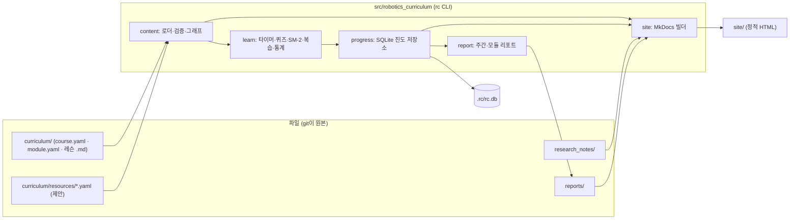
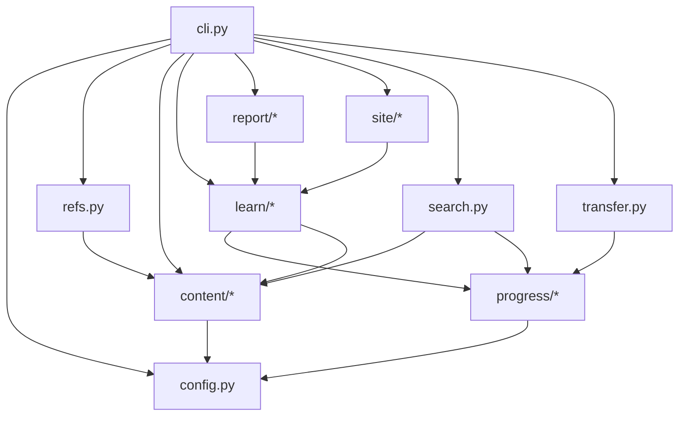

# 플랫폼 설계 문서 (Platform Design)

| 항목 | 내용 |
|---|---|
| 문서 버전 | 0.3 (Draft) |
| 작성일 | 2026-11-11 |
| 상태 | 검토 대기 |
| 상위 문서 | `docs/PRD.md` v0.2 (기능 요구사항·릴리스 계획은 그 문서를 따르며 여기서 반복하지 않는다) |
| 관련 결정 | `docs/adr/0001-phase1-stack.md` (Phase 1 = Python 단일 스택) |
| 콘텐츠 스키마 확정본 | `docs/curriculum/CONTENT_MODEL.md`, `src/robotics_curriculum/content/models.py`. 이 문서 §3은 요약이며 충돌 시 구현이 우선 |
| 전제 | 패키지 `src/robotics_curriculum/`, CLI `rc`(typer), pydantic v2, 콘텐츠 `curriculum/`, 정적 사이트 MkDocs → `site/`, 진도 저장 SQLite(`progress/` 패키지) |

**제품 한 줄 정의**: "로보틱스 전문가 코스" 하나를 위한 전용 커리큘럼 플랫폼. 기초 → 중급 → 고급 단계로 묶인 모듈을 순서대로 학습하고, 개인 진도를 기록하며, 각 단계에서 **무엇을 읽고·어떤 문제를 풀고·어떤 강의를 볼지**(학습 방법과 자료)를 바로 열람한다. 시뮬레이터 연동 같은 복잡한 기능은 범위 밖이다(사용자 결정, 2026-11-11).

이 문서의 범위.

1. 정보 구조(IA)와 정적 사이트 페이지 구조·와이어프레임
2. 콘텐츠 디렉터리·스키마 요약과 "단계별 학습 방법·자료" 확장안
3. 진도 데이터 모델과 SQLite 스키마
4. `rc` CLI 명령별 입출력
5. 패키지 모듈 구성과 의존 다이어그램

---

## 1. 전체 구조



- **콘텐츠는 파일이 원본**. `rc`는 실행 때마다 `curriculum/`을 로드·검증한다(Phase 1 규모에서는 색인 캐시 없이도 1초 안에 끝난다. 느려지면 해시 기반 캐시를 `progress/`와 같은 DB 파일에 추가).
- **학습 데이터는 SQLite가 원본**. `rc export`로 JSON을 뽑는다.

---

## 2. 정보 구조 (IA)

### 2.1 콘텐츠 계층과 식별자 (구현 기준)

| 계층 | 위치 | ID | 예 |
|---|---|---|---|
| Course | `curriculum/<course-dir>/course.yaml` | slug | `robotics-expert` (코스는 하나) |
| Module | `curriculum/<course-dir>/<module-dir>/module.yaml` | slug, 코스 내 유일 | `m3-kinematics` |
| Lesson | `.../<module-dir>/<lesson>.md` | slug, 코스 내 유일. 관례 `<모듈 접두어>-<주제>` | `m3-forward-kinematics` |
| Activity | 레슨 프런트매터 `activities[]` | slug, 코스 내 유일. 관례 `<lesson-id>-<kind>` | `m3-forward-kinematics-quiz` |
| Resource (제안) | `curriculum/resources/*.yaml` | slug, 저장소 전체 유일 | `lynch-park-modern-robotics` |
| Stage (제안) | 모듈의 `level` 필드 | `basic` · `intermediate` · `advanced` | 기초 / 중급 / 고급 |

- CLI 인자는 전체 ID 또는 유일한 접두어를 받는다. 둘 이상 매칭되면 후보를 보여주고 종료 코드 2.
- 단계(Stage)는 별도 디렉터리가 아니라 모듈 메타데이터다. 로드맵·대시보드는 `level`로 모듈을 묶어 보여준다.

### 2.2 정적 사이트 페이지 구조

`rc build`가 MkDocs(Material 테마)로 생성한다. 쓰기 동작은 전부 CLI에 있고 사이트는 읽기 전용이다.

```
site/
├─ index.html                      대시보드: 현재 단계·모듈·다음 레슨, 단계별 진행률, 이번 주, 복습
├─ roadmap/                        로드맵: 단계(기초/중급/고급)별로 묶인 모듈과 선수지식 그래프
├─ modules/<module>/               모듈 개요: 레슨 목록·상태, 모듈 학습 가이드, 모듈 자료
├─ modules/<module>/<lesson>/      레슨 페이지: 본문, "이 단계 공부법", 자료 목록, 퀴즈 미리보기, 노트
├─ resources/                      자료실: 유형·단계·주제 필터, 읽기 상태
├─ reports/                        reports/*.md 복사본
├─ notes/                          research_notes/ 색인 (P1)
└─ assets/                         KaTeX, Mermaid, 생성된 progress.json
```

내비게이션(좌측): 대시보드 · 로드맵 · 기초 › 모듈 › 레슨 · 중급 › … · 고급 › … · 자료실 · 리포트 · 노트.

### 2.3 와이어프레임

**대시보드 `index.html`**
```
┌──────────────────────────────────────────────────────────────────────┐
│ 로보틱스 전문가 코스   대시보드 | 로드맵 | 기초 | 중급 | 고급 | 자료실  🌙 │
├──────────────────────────────────────────────────────────────────────┤
│ 빌드: 2026-11-11 21:03  (진도 반영은 `rc build` 재실행)                 │
│                                                                      │
│ 현재 위치                                                              │
│  단계  중급  ▸  모듈  M3 로봇 운동학 (2/5 레슨)  ▸  다음  m3-forward-kinematics│
│  [이 레슨 공부법 보기]   시작: rc start m3-forward-kinematics             │
│                                                                      │
│ 단계별 진행률                                                           │
│  기초   M1 수학·물리 ████████ 100%   M2 프로그래밍·툴 ████████ 100%  ✔ 완료 │
│  중급   M3 운동학 ███░░░░░ 40%   M4 제어 ░░░░ 0%   M5 센서·인식 ░░░░ 0%    │
│  고급   M6 모션 플래닝 ▨   M7 SLAM ▨   M8 ROS 2 ▨   M9 캡스톤 ▨  (잠김)    │
│                                                                      │
│ ┌ 이번 주 ──────────┐ ┌ 연속 학습 ─┐ ┌ 오늘 복습 ─┐ ┌ 읽는 중인 자료 ─────┐ │
│ │ 4h 35m / 5h  91%  │ │ 🔥 7일     │ │ 12장       │ │ Modern Robotics ch.4│ │
│ └───────────────────┘ └────────────┘ └────────────┘ │ 3Blue1Brown 선형대수 │ │
│                                                     └─────────────────────┘ │
│ 최근 활동                                                               │
│  11/11 m3-dh-parameters 완료 (이해도 4) · 11/10 퀴즈 m3-dh 4/5            │
└──────────────────────────────────────────────────────────────────────┘
```

**로드맵 `roadmap/`**
```
┌──────────────────────────────────────────────────────────────────────┐
│ 로드맵 — 단계별 모듈            범례: ■완료 ▣진행중 □가능 ▨잠김(선수 미완) │
│                                                                      │
│ ┌ 기초 (완료) ─────────────┐ ┌ 중급 (진행 중 40%) ────┐ ┌ 고급 (잠김) ───┐│
│ │ ■ M1 수학·물리 기초       │ │ ▣ M3 로봇 운동학       │ │ ▨ M6 모션 플래닝││
│ │   m1-vectors ■ m1-rot ■  │ │   m3-dh ■ m3-fk ▣ m3-ik ▨│ │ ▨ M7 SLAM       ││
│ │ ■ M2 프로그래밍·툴       │─▶ □ M4 제어             │─▶ ▨ M8 ROS 2      ││
│ │   m2-python ■ m2-git ■   │ │ □ M5 센서·인식         │ │ ▨ M9 캡스톤     ││
│ └──────────────────────────┘ └───────────────────────┘ └────────────────┘│
│                                                                      │
│ 선수지식 그래프 (Mermaid, 노드 클릭 → 레슨)                               │
│  m1-vectors → m1-rotations → m3-dh → m3-fk → m3-ik → m6-planning …      │
└──────────────────────────────────────────────────────────────────────┘
```

**레슨 페이지 `modules/m3-kinematics/m3-forward-kinematics/`**
```
┌───────────────┬────────────────────────────────────────────┬───────────┐
│ ◂ 중급         │ 정기구학 (Forward Kinematics)                │ 이 페이지  │
│ M3 로봇 운동학  │ 중급 · M3 · ⏱ 40분 · 난이도 ●●●○○ · 선수: m3-dh  │ 공부법    │
│  ■ m3-dh       │ 상태: 진행 중 (활동 1/3)                      │ 자료      │
│  ▣ m3-fk       │                                            │ 1. 정의    │
│  ▨ m3-ik       │ 학습 목표                                   │ 2. 유도    │
│ M4 제어        │  • DH 표에서 T_0^n 을 계산한다                │ 3. 예제    │
│  □ m4-pid      │  • 2링크 팔의 끝점 위치를 코드로 구한다        │ 퀴즈      │
│  …             │                                            │ 노트      │
│               │ ┌ 이 단계 공부법 ───────────────────────────┐ │           │
│               │ │ 1. 읽기  Modern Robotics 4.1–4.2 (60분)    │ │           │
│               │ │    └ 포인트: 공간 vs 물체 프레임 PoE 구분    │ │           │
│               │ │ 2. 보기  Lynch 강의 영상 "FK of open chains"│ │           │
│               │ │ 3. 본문  아래 1~3절 읽고 예제 손으로 재현    │ │           │
│               │ │ 4. 풀기  연습문제 MR 4.1, 4.5 + 퀴즈 3문항  │ │           │
│               │ │ 5. 쓰기  노트에 "DH vs PoE 차이" 한 단락     │ │           │
│               │ │ 완료 조건: 퀴즈 ≥ 2/3, 이해도 자기평가 ≥ 3   │ │           │
│               │ └────────────────────────────────────────────┘ │           │
│               │ ┌ 자료 ──────────────────────────────────────┐ │           │
│               │ │ 📘 Modern Robotics ch.4   교재 · 무료 · 중급 │ │           │
│               │ │ 🎞 Lynch FK 강의 (12분)   영상 · 무료        │ │           │
│               │ │ 📄 Craig ch.3             교재 · 유료 · 보조 │ │           │
│               │ │ 📝 내 노트 research_notes/…/m3-fk.md         │ │           │
│               │ └────────────────────────────────────────────┘ │           │
│               │ ## 1. 정의                                   │           │
│               │ $$ T_0^n = \prod_{i=1}^{n} A_i(\theta_i) $$  │           │
│               │ …                                            │           │
│               │ ┌ 퀴즈 (3문항) · 터미널: rc quiz m3-fk ───────┐ │           │
│               │ │ Q1. DH 변환 A_i 의 곱 순서는? (객관식)        │ │           │
│               │ └────────────────────────────────────────────┘ │           │
│               │ ◂ m3-dh-parameters            m3-inverse-kinematics ▸│       │
└───────────────┴────────────────────────────────────────────┴───────────┘
```

**모듈 페이지 `modules/m3-kinematics/`**: 모듈 요약, 단계·선수 모듈, 레슨 목록(상태·시간), **모듈 학습 가이드**(이 모듈을 어떤 순서로·몇 주에 걸쳐·어떤 교재 중심으로 공부할지), 모듈 공통 자료, 모듈 리포트 링크.

**자료실 `resources/`**: 표(제목·유형·단계·주제·비용·언어·읽기 상태), 상단 필터(유형·단계·주제·무료만), 각 행 클릭 → 자료가 쓰이는 레슨 목록.

### 2.4 Figma

Figma 파일은 위 네 화면(대시보드·로드맵·레슨·자료실)을 데스크톱 1440 기준으로 옮긴다. 페이지 구성 `00 Cover · 01 Tokens · 02 Components(모듈 카드, 레슨 행, 공부법 스텝, 자료 행, 진행률 바) · 03 Dashboard · 04 Roadmap · 05 Lesson · 06 Resources`. 링크: (Figma MCP 인증 후 기입)

---

## 3. 콘텐츠 디렉터리·스키마

> 확정본은 `docs/curriculum/CONTENT_MODEL.md`. 아래 "구현" 표시는 현재 구현과 같고, "제안(미구현)"은 이 문서가 추가를 제안하는 확장이다. 프런트매터에 정의되지 않은 키는 에러이므로, 제안 필드는 모델에 추가되기 전에는 쓸 수 없다.

### 3.1 디렉터리 (구현)

```
curriculum/
├─ robotics-expert/                 # 코스 하나 = 디렉터리 하나
│  ├─ course.yaml
│  ├─ m1-math-physics/
│  │  ├─ module.yaml
│  │  ├─ m1-vectors-matrices.md
│  │  └─ m1-rotations.md
│  ├─ m2-programming-tools/
│  ├─ m3-kinematics/
│  └─ …
└─ resources/                       # 제안(미구현): 자료 카탈로그
   ├─ foundations.yaml
   ├─ ros2.yaml
   └─ …
```

### 3.2 `course.yaml` / `module.yaml`

```yaml
# course.yaml (구현)
id: robotics-expert
title: 로보틱스 전문가 코스
summary: 기초 수학부터 SLAM·ROS 2·캡스톤까지 단계별로 완주하는 단일 코스
tags: [robotics]
modules: [m1-math-physics, m2-programming-tools, m3-kinematics, m4-control, m5-sensing,
          m6-motion-planning, m7-slam, m8-ros2, m9-capstone]
```

```yaml
# module.yaml
id: m3-kinematics                      # 구현
title: 로봇 운동학                      # 구현
summary: DH 파라미터부터 역기구학까지     # 구현
lessons: [m3-dh-parameters, m3-forward-kinematics, m3-inverse-kinematics]   # 구현
level: intermediate                    # 제안(반영 중): basic | intermediate | advanced
prerequisites: [m1-math-physics]       # 제안(미구현): 모듈 단위 선수지식
study_guide: |                         # 제안(미구현): 모듈 학습 가이드 (Markdown)
  2주 권장. Modern Robotics 3–4장을 축으로 읽고, 각 레슨 퀴즈를 통과한 뒤
  마지막에 2링크 FK/IK를 손으로 유도해 노트에 남긴다.
resources: [lynch-park-modern-robotics, craig-intro-robotics]   # 제안(미구현)
```

### 3.3 레슨 프런트매터

```yaml
---
id: m3-forward-kinematics             # 구현
title: 정기구학                        # 구현
summary: DH 표에서 엔드이펙터 자세를 계산한다            # 구현
objectives:                           # 구현 (1개 이상)
  - DH 표에서 T_0^n 을 계산한다
  - 2링크 팔의 끝점 위치를 코드로 구한다
prerequisites: [m3-dh-parameters]     # 구현 (레슨 ID)
difficulty: 3                         # 구현 (1~5)
estimated_minutes: 40                 # 구현
tags: [기구학, DH]                     # 구현
activities:                           # 구현: id, kind(reading|quiz|lab|exercise), title, estimated_minutes
  - { id: m3-forward-kinematics-reading, kind: reading, title: 본문 읽기, estimated_minutes: 25 }
  - { id: m3-forward-kinematics-quiz, kind: quiz, title: 퀴즈 3문항, estimated_minutes: 5 }
  - { id: m3-forward-kinematics-exercise, kind: exercise, title: MR 연습문제 4.1·4.5, estimated_minutes: 30 }

# ---- 제안(미구현) ----
study_plan:                           # "이 단계 공부법": 순서대로 무엇을 할지
  - { action: read,  resource: lynch-park-modern-robotics, where: "4.1–4.2", minutes: 60,
      note: "공간 프레임 PoE와 물체 프레임 PoE 구분에 집중" }
  - { action: watch, resource: lynch-fk-video, minutes: 12 }
  - { action: read,  where: "본문 1~3절", minutes: 25, note: "예제를 손으로 재현" }
  - { action: solve, resource: lynch-park-modern-robotics, where: "연습문제 4.1, 4.5", minutes: 30 }
  - { action: write, where: "노트", note: "DH vs PoE 차이 한 단락" }
completion_criteria: "퀴즈 2/3 이상, 이해도 자기평가 3 이상"
resources: [lynch-park-modern-robotics, lynch-fk-video, craig-intro-robotics]
concepts:                             # 플래시카드 원천 (FR-4.2)
  - { front: "DH 변환 A_i 의 4개 기본 변환 순서는?", back: "Rot_z(θ)·Trans_z(d)·Trans_x(a)·Rot_x(α)" }
---
```

- `study_plan[].action`: `read` · `watch` · `solve` · `write` · `build` · `review`. `resource`는 자료 ID(선택), `where`는 장·절·문제 번호·URL 조각 등 자유 문자열.
- 활동 `kind`에 외부 강의 수강용 `external`을 추가하는 것을 제안한다(PRD FR-1.3). `lab`은 모델에 남아 있으나 이 코스에서는 쓰지 않는다.

### 3.4 본문 안의 퀴즈 블록 (제안, 미구현)

레슨 Markdown 안의 `quiz` 펜스 블록(내부 YAML)으로 정의한다(FR-4.1). 사이트에서는 문항·선택지만 보이고 정답은 숨긴다.

````markdown
```quiz
- id: q1
  type: single            # single | multi | short | truefalse
  prompt: "DH 변환 A_i 를 이루는 기본 변환의 곱 순서는?"
  choices: ["Rot_x·Trans_x·Trans_z·Rot_z", "Rot_z·Trans_z·Trans_x·Rot_x", "Trans_z·Rot_z·Rot_x·Trans_x"]
  answer: 1               # 0-based; multi 는 리스트; short 는 허용 답 리스트; truefalse 는 bool
  explanation: "관절축(z) 기준 회전·이동 뒤 링크축(x) 기준 이동·회전."
  card: true              # 맞혀도 플래시카드로 만들지 (기본 false)
```
````

### 3.5 `resources/*.yaml` (제안, 미구현 — 리서치 세션과 합의한 스키마)

```yaml
- id: lynch-park-modern-robotics      # kebab-case, 저장소 전체 유일
  type: book            # book | video_series | course | docs | repo | paper | article | hardware | dataset_model | community | competition_curriculum
  title: Modern Robotics: Mechanics, Planning, and Control
  author: Kevin Lynch, Frank Park
  url: http://modernrobotics.org
  language: en          # ko | en | other  (다국어는 extra.languages)
  cost: { kind: free }  # kind: free | paid, amount, currency (원문 가격은 extra.cost_note)
  level: intermediate   # beginner | intermediate | advanced
  prerequisites: []
  topics: [기구학, 동역학, 제어]
  est_hours: 80
  last_updated: 2019
  status: active        # active | stale | discontinued | unverified
  license: CC BY-NC-SA
  quality_signal: "교과서 표준, 강의 영상·연습문제 공개"
  notes: "수식 밀도 높음. M3 전에 2~3장 먼저."
  source_checked_date: 2026-11-11
  extra: { isbn: "9781107156302", edition: 1, korean_edition: false }
```

읽기 상태(미독/읽는 중/완료, FR-6.3)는 콘텐츠가 아니라 진도 DB(`resource_status`)에 둔다.

### 3.6 검증 (구현 + 제안)

구현된 규칙 1~7은 CONTENT_MODEL.md 참조. 제안 필드가 추가되면 다음을 더한다: `resources`·`study_plan[].resource`가 존재하는 자료 ID인지(E), `level` 값이 enum인지(E), 모듈 `prerequisites`가 존재하는 모듈 ID이고 순환이 없는지(E), 레슨에 `study_plan`이 없으면 경고(W), `quiz` 블록 YAML 파싱·`answer` 범위(E).

---

## 4. 진도 데이터 모델과 SQLite 스키마

> 구현: `src/robotics_curriculum/progress/` (`store.py`의 `ProgressStore` 인터페이스 + `SqliteProgressStore`, `service.py`). P1-1 에이전트가 구현 중이며 **세부 컬럼은 구현 기준으로 확정 예정**. 아래는 기본 테이블 2개와 이후 확장안이다. 모든 테이블에 `user_id`(기본 1)를 둔다.

### 4.1 기본 테이블 (P1-1)

```sql
lesson_progress(user_id, lesson_id, status, understanding, note, updated_at,
                PRIMARY KEY(user_id, lesson_id))
  -- status: not_started | in_progress | done ; understanding: 1~5 또는 NULL
sessions(id PK, user_id, lesson_id, started_at, ended_at, minutes, source)
  -- source: timer | manual ; 열린 세션은 ended_at IS NULL
meta(key PK, value)   -- schema_version 등
```

활동 단위 상태가 필요하면 `activity_progress(user_id, activity_id, status, updated_at)`를 추가하고 레슨 상태를 파생한다(모든 활동 done → 레슨 done). Phase 1 초기에는 레슨 단위만으로 시작한다.

### 4.2 확장 테이블 (Phase 1 후반 ~ Phase 2)

```sql
cards(id PK, user_id, lesson_id, front, back, source, created_at, suspended)
  -- id: "<lesson_id>-concept-<n>" | "<lesson_id>-quiz-<qid>" ; source: concept | quiz
card_state(card_id PK, user_id, repetitions, interval_days, ease, due)        -- SM-2
reviews(id PK, card_id, user_id, reviewed_at, rating, interval_before, interval_after, ease_after)
quiz_attempts(id PK, user_id, lesson_id, question_id, answered_at, answer, correct)
resource_status(user_id, resource_id, status, summary, updated_at, PRIMARY KEY(user_id, resource_id))
  -- status: unread | reading | done (FR-6.3)
notes(lesson_id PK, path, updated_at)                                          -- research_notes/ 색인
reports(id PK, user_id, kind, period, path, generated_at)                      -- kind: weekly | module
```

pydantic 모델은 테이블과 1:1(`Progress`, `Session`, `Card`, `CardState`, `Review`, `QuizAttempt`, `ResourceStatus`, `Note`, `Report`)로 `progress/models.py`에 둔다. 학습 테이블은 콘텐츠에 FK를 걸지 않는다(콘텐츠 ID 문자열만 보관).

### 4.3 파생 규칙

| 파생값 | 계산 |
|---|---|
| 레슨 잠김 | 선수 레슨 중 `done`이 아닌 것이 있으면 잠김(강제 열기 가능, FR-2.2) |
| 모듈 진행률 | `done` 레슨 수 / 레슨 수 |
| 단계 진행률 | 해당 `level` 모듈들의 레슨 기준 합산 |
| 현재 단계·모듈 | `in_progress` 레슨이 있으면 그 모듈, 없으면 `rc next`가 고른 레슨의 모듈 |
| 주간 학습 시간 | `sessions.minutes` 합 (ISO 주, 월요일 시작) |
| 연속 학습일 | `sessions` 또는 `lesson_progress.updated_at`이 있는 날짜의 연속 길이 |
| 오늘 복습 수 | `card_state.due <= now` 이고 `suspended = 0` |

---

## 5. `rc` CLI 설계

### 5.1 공통 규약

- 참조 인자(`<lesson>`, `<module>`, `<resource>`)는 전체 ID 또는 유일 접두어.
- 텍스트 출력이 기본, `--json`이면 JSON 한 덩어리. 에러·경고는 stderr.
- 종료 코드: `0` 성공, `1` 검증 실패, `2` 사용 오류(모호한 참조, 잘못된 인자).
- 전역 옵션: `--root <dir>`(기본: cwd에서 위로 `curriculum/` 탐색), `--db <path>`, `--user <id>`, `--json`, `-q`.
- 설정 `.rc/config.toml`(저장소 루트, git 무시):

```toml
[paths]
db = ".rc/rc.db"
site = "site"
notes = "research_notes"

[goals]
weekly_minutes = 300
```

### 5.2 명령 목록

| 명령 | 인자·옵션 | 읽음 | 씀 | 출력 요지 |
|---|---|---|---|---|
| `rc validate [path]` | `--strict` | `curriculum/` | 없음 | `파일경로: 메시지` 목록, `OK: N lessons in M modules` |
| `rc build` | `--out site/`, `--serve`, `--no-progress` | 콘텐츠, DB, `research_notes/`, `reports/` | `build/mkdocs/`, `site/` | 생성 페이지 수 |
| `rc status [module\|lesson]` | `--week` | 콘텐츠, DB | 없음 | 현재 단계·모듈·다음 레슨, 단계별 진행률 |
| `rc next` | `-n <k>` | 콘텐츠, DB | 없음 | 추천 레슨 + 이유 + 공부법 첫 줄 |
| `rc guide <lesson\|module>` (제안) | `--resources` | 콘텐츠 | 없음 | "이 단계 공부법" 스텝과 자료 목록 |
| `rc start <lesson>` | | DB | `sessions`, `lesson_progress` | 시작 시각 |
| `rc stop` | `--discard` | DB | `sessions` | 경과 시간 |
| `rc log <duration> [lesson]` | `--on <date>` | DB | `sessions` | 기록된 분 |
| `rc done <lesson>` | `-u <1-5>`, `-m "<메모>"`, `--undo` | 콘텐츠, DB | `lesson_progress`, `cards` | 상태, 해금된 레슨 |
| `rc quiz <lesson>` | `--only <qid,…>`, `--retry-wrong` | 콘텐츠, DB | `quiz_attempts`, `cards` | 문항별 채점, 점수 |
| `rc review` | `-n <k>`, `--lesson <id>`, `--dry-run` | DB | `reviews`, `card_state` | 카드 제시, 요약 |
| `rc note <lesson>` | `--print` | 콘텐츠 | `research_notes/<module>/<lesson>.md`, `notes` | `$EDITOR`로 연 뒤 경로 |
| `rc resource <id> [--status reading\|done]` (제안) | | 콘텐츠 | `resource_status` | 자료 상세, 상태 변경 |
| `rc report weekly [YYYY-Www]` | `--open` | DB, 콘텐츠 | `reports/YYYY-Www.md`, `reports` | 파일 경로 |
| `rc report module <module>` | | DB, 콘텐츠 | `reports/module-<id>.md`, `reports` | 파일 경로 |
| `rc search <query>` | `--in lessons\|notes\|resources\|cards`, `-n` | 콘텐츠, 노트 | 없음 | 매치 목록 |
| `rc export [file]` | `--since <date>` | DB | `rc-export-<date>.json` | 레코드 수 |
| `rc import <file>` | `--merge\|--replace`, `--dry-run` | 파일 | 학습 테이블 | 반영 수, 충돌 |
| `rc version` | | | | 버전 |

### 5.3 명령별 상세

**`rc status`**
```
$ rc status
로보틱스 전문가 코스   전체 31%   이번 주 4h 35m / 5h   연속 7일   오늘 복습 12장
현재: 중급 › M3 로봇 운동학 (2/5) › 다음 m3-forward-kinematics
  기초   ████████ 100%   M1 ■  M2 ■
  중급   ███░░░░░  27%   M3 ▣ 40%   M4 □ 0%   M5 □ 0%
  고급   ░░░░░░░░   0%   M6 ▨  M7 ▨  M8 ▨  M9 ▨   (선수 미완료)
공부법: rc guide m3-forward-kinematics   시작: rc start m3-forward-kinematics
```

**`rc next`** — 선수지식 충족 ∧ 미완료 레슨 중 `course.modules → module.lessons` 순으로 가장 앞선 것. `in_progress`가 있으면 그것이 1순위.
```
$ rc next
▶ m3-forward-kinematics  정기구학  (중급 · M3 · 40분 · 난이도 3)
  이유: 진행 중 · 남은 활동: quiz, exercise
  공부법 1단계: 읽기 Modern Robotics 4.1–4.2 (60분)  → 전체: rc guide m3-forward-kinematics
```

**`rc guide`** (제안) — 레슨이면 `study_plan`·`completion_criteria`·자료를, 모듈이면 `study_guide`와 레슨별 첫 스텝을 출력.
```
$ rc guide m3-forward-kinematics
정기구학 — 이 단계 공부법 (예상 2h 30m)
 1. 읽기  Modern Robotics 4.1–4.2            60분   공간 vs 물체 프레임 PoE 구분
 2. 보기  Lynch "FK of open chains" (12분)    12분
 3. 읽기  본문 1~3절                           25분   예제를 손으로 재현
 4. 풀기  MR 연습문제 4.1, 4.5                 30분
 5. 쓰기  노트: DH vs PoE 차이 한 단락
완료 조건: 퀴즈 2/3 이상, 이해도 자기평가 3 이상
자료
 📘 Modern Robotics ch.4   book · free · intermediate · 읽는 중   http://modernrobotics.org
 🎞 Lynch FK 강의           video_series · free
 📄 Craig ch.3              book · paid · 보조
```

**`rc start / stop / log`** — `start`는 열린 세션이 있으면 거부(종료 코드 2). 레슨이 `not_started`면 `in_progress`로. `stop`은 분 단위 반올림(최소 1분), `--discard`는 삭제. `log 45m` / `1h30m` / `90`.

**`rc done`**
```
$ rc done m3-forward-kinematics -u 4 -m "자코비안은 아직 감이 없음"
✔ 정기구학 완료  이해도 4
  플래시카드 1장 생성 (concepts) → 내일부터 rc review
  해금: m3-inverse-kinematics
```
완료 시 `concepts`를 카드로 등록(`due = 내일 00:00`). `--undo`는 `in_progress`로 되돌린다.

**`rc quiz`** — 문항을 순서대로 묻고 즉시 채점. `single` 인덱스 일치, `multi` 집합 일치, `short` 정규화(trim·소문자·공백 축약) 후 허용 답 중 하나, `truefalse` bool. 오답과 `card: true` 문항은 `cards(source=quiz)`로. 마지막에 `결과 2/3 (67%)  오답 1 → 카드 1장`.

**`rc review` (SM-2)** — due 카드를 하나씩: 앞면 → Enter → 뒷면 → `1 again · 2 hard · 3 good · 4 easy`. 계산(`learn/sm2.py`, 순수 함수, 단위 테스트 필수), q = again 1 / hard 3 / good 4 / easy 5:
```
if q < 3: repetitions = 0; interval = 1
else:
    repetitions += 1
    interval = 1 if repetitions == 1 else 6 if repetitions == 2 else round(interval * ease)
ease = max(1.3, ease + (0.1 - (5 - q) * (0.08 + (5 - q) * 0.02)))
due = today + interval days
```
같은 세션의 `again` 카드는 세션 끝에 다시(최대 2회).

**`rc report weekly`** — 템플릿 `report/templates/weekly.md.j2`: 요약(학습 시간·세션·연속일, 완료 레슨·퀴즈 정답률, 복습 수), 완료 레슨 표(이해도·시간·메모), 막힌 지점(again 2회 이상 카드, 메모), 다음 주 제안(`rc next` 결과와 그 공부법 첫 스텝). `rc report module`은 모듈 레슨별 상태·이해도 분포·자료 읽기 상태.

**`rc build`**
1. `build/mkdocs/docs/`에 변환 복사: 레슨 프런트매터 → 헤더 블록(단계·모듈·시간·난이도·선수·상태), `study_plan` → "이 단계 공부법" 섹션, `resources` → 자료 카드, `quiz` 블록 → 문항만 남긴 admonition.
2. DB에서 `progress.json`(레슨 상태, 모듈·단계 진행률, 현재 위치, 주간 시간, streak, due 수, 자료 읽기 상태)을 생성해 `docs/assets/`에 두고 대시보드·로드맵·모듈 페이지를 Jinja로 생성.
3. 로드맵: 단계별 모듈 카드 + Mermaid `flowchart LR` 선수지식 그래프(노드 class `done/in_progress/available/locked`).
4. `mkdocs.yml` 생성(Material, `pymdownx.arithmatex`, `pymdownx.superfences`+mermaid, `search`, 다크 모드) → `mkdocs build -d site/`. `--serve`는 `mkdocs serve`.

**`rc search`** — 레슨 본문·노트·자료·카드를 단순 부분 일치(Phase 1) 또는 FTS5(Phase 2)로 검색. 출력 `구분  ID  제목  "…스니펫…"`.

**`rc export / import`** — `{"schema_version": 1, "exported_at", "user_id", "lesson_progress": [], "sessions": [], "cards": [], "card_state": [], "reviews": [], "quiz_attempts": [], "resource_status": [], "reports": []}`. `--merge`는 PK 충돌 시 `updated_at`이 늦은 쪽, `--replace`는 학습 테이블을 비우고 넣는다.

---

## 6. 패키지 모듈 구성과 의존

```
src/robotics_curriculum/
├─ __init__.py            __version__
├─ cli.py                 typer 앱. 서브커맨드 등록과 출력 포맷(JSON/텍스트)만 담당
├─ config.py              루트 탐색, config.toml 로드, 경로 객체
├─ refs.py                ID·접두어 해석 (모호성 처리)
├─ content/               (구현) models.py · loader.py · validate.py
│  ├─ graph.py            선수지식 DAG, 잠김 판정, next 추천
│  ├─ quiz_block.py       (제안) 본문 ```quiz 블록 파서
│  └─ resources.py        (제안) resources/*.yaml 로더
├─ progress/              (구현 중) store.py (ProgressStore, SqliteProgressStore) · service.py · models.py
│  └─ migrations/0001_init.sql …
├─ learn/
│  ├─ timer.py            start/stop/log
│  ├─ quiz.py             문항 제시·채점 (prompt 함수 주입)
│  ├─ sm2.py              순수 함수 schedule(state, rating, today)
│  ├─ review.py           due 카드 선택·세션 진행
│  ├─ guide.py            study_plan·study_guide 조립 (rc guide, 사이트, 리포트 공용)
│  └─ stats.py            단계·모듈 진행률, 현재 위치, 주간 시간, streak, due 수
├─ report/                weekly.py · module.py · templates/*.md.j2
├─ site/                  builder.py · transform.py · roadmap.py · templates/*.j2
├─ search.py
└─ transfer.py            export/import
```



- `progress`는 `content`를 모른다(문자열 ID만). `content`는 `progress`를 모른다. 둘을 잇는 것은 `learn`뿐이며 `report`·`site`는 `learn`을 통해 통계·가이드를 받는다.
- `cli.py`만 typer와 터미널 I/O를 안다. `quiz.py`·`review.py`는 `prompt: Callable[[str], str]`를 주입받아 테스트에서 자동 응답한다.
- `sm2.py`, `graph.py`, `stats.py`, `guide.py`, `report/*`는 순수 함수 위주로 두고 단위 테스트 필수(PRD 7절).
- 추가 의존(예정): `mkdocs`, `mkdocs-material`, `pymdown-extensions`, `jinja2`. SQLite는 표준 라이브러리.

---

## 7. 테스트 전략 (요약)

| 대상 | 방식 |
|---|---|
| content 로더·검증, quiz 블록, resources | 픽스처 `tests/fixtures/curriculum_ok/`, `curriculum_bad/` (규칙별 1파일) |
| graph(next, 잠김), stats, guide, sm2 | 인라인 모델, 표 기반 단위 테스트 |
| progress store | `tmp_path` SQLite, 마이그레이션 적용 후 CRUD |
| CLI | `typer.testing.CliRunner` + 픽스처 코스 + 임시 DB, 명령별 happy path와 종료 코드 |
| site builder | 빌드 결과에 기대 파일·문자열("이 단계 공부법", 단계 카드) 존재 확인 |

---

## 8. 열린 항목

| # | 항목 | 현재 가정 | 담당 |
|---|---|---|---|
| 1 | 모듈 `level`·`prerequisites`·`study_guide`, 레슨 `study_plan`·`resources`·`concepts`, 활동 `external` | 콘텐츠 모델 정리 에이전트가 `level`부터 반영 중; 나머지는 이 문서 제안 | 콘텐츠 모델 담당 |
| 2 | `resources/*.yaml` 6개 파일(foundations, ros2, simulators, hardware, korean, ai_robot_learning) | 리서치 세션이 §3.5 스키마로 생성 중 (`worktree-research`) | 리서치 세션 |
| 3 | 활동 단위 진도(`activity_progress`) 도입 시점 | 레슨 단위로 시작, 퀴즈·연습문제 상태가 필요해지면 추가 | P1-1 |
| 4 | 9개 모듈과 단계 배정(기초 M1–M2, 중급 M3–M5, 고급 M6–M9) | 예시. 리서치 결과에 따라 조정 | 오케스트레이터 |
| 5 | Figma 파일 링크 | Figma MCP 인증·세션 재시작 후 §2.4 기준으로 작성 | 이 세션 |
