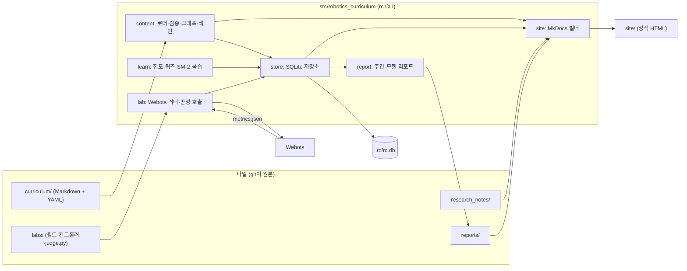
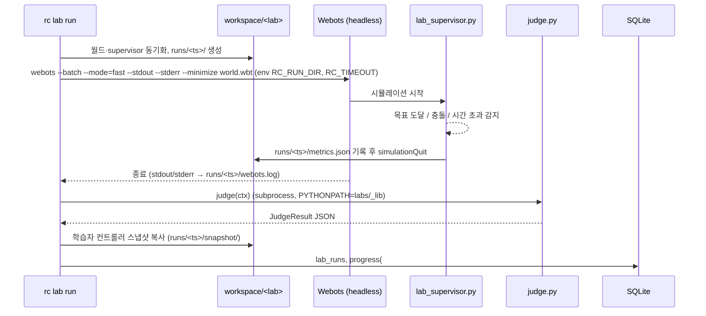
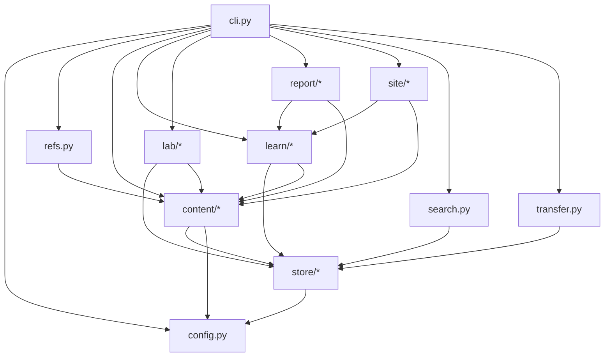

# 플랫폼 설계 문서 (Platform Design)

| 항목 | 내용 |
|---|---|
| 문서 버전 | 0.2 (Draft) |
| 작성일 | 2026-11-11 |
| 상태 | 검토 대기 |
| 상위 문서 | `docs/PRD.md` v0.2 (기능 요구사항·릴리스 계획은 그 문서를 따르며 여기서 반복하지 않는다) |
| 관련 결정 | `docs/adr/0001-phase1-stack.md` (Phase 1 = Python 단일 스택) |
| 콘텐츠 스키마 상세 | `docs/curriculum/CONTENT_MODEL.md` (M1 구현 에이전트가 작성 중. 이 문서 §3은 요약·예시이며 충돌 시 CONTENT_MODEL.md가 우선) |
| 전제 | 패키지 `src/robotics_curriculum/`, CLI `rc`(typer), pydantic v2, 콘텐츠 `curriculum/`, 실습 `labs/`, 정적 사이트 MkDocs → `site/`, 진도 저장 SQLite |

이 문서는 PRD가 정한 기능을 **어떻게** 만들지 정한다. 범위는 다음 여섯 가지다.

1. 정보 구조(IA)와 정적 사이트 페이지 구조
2. 콘텐츠 디렉터리 구조와 프런트매터 스키마 요약
3. 진도 데이터 모델과 SQLite 스키마
4. `rc` CLI 명령별 입출력 설계
5. 패키지 모듈 구성과 의존 다이어그램
6. 실습 판정 인터페이스 (`judge.py`, `metrics.json`)

Phase 1에는 GUI가 없으므로 화면 설계는 정적 사이트 페이지와 터미널 출력의 ASCII 와이어프레임으로 한다. Figma 파일은 §2.3 와이어프레임을 옮겨 만들며, 링크는 §9에 적는다.

---

## 1. 전체 구조 한눈에



원칙 두 가지.

- **콘텐츠는 파일이 원본, DB는 캐시**: `curriculum/`을 바꾸면 다음 `rc` 실행 때 변경된 파일만 재색인한다(파일 해시 비교).
- **학습 데이터는 DB가 원본**: 진도·세션·카드·복습·실습 결과는 SQLite에만 쓰고, `rc export`로 JSON을 뽑는다.

---

## 2. 정보 구조 (IA)

### 2.1 콘텐츠 계층과 식별자

| 계층 | 위치 | ID 형식 | 예 |
|---|---|---|---|
| Track | `curriculum/tracks/<track>/` | `<track>` | `robotics-basics` |
| Module | `curriculum/tracks/<track>/<module>/` | `<track>/<module>` | `robotics-basics/m2-kinematics` |
| Lesson | `.../<module>/<lesson>.md` | `<track>/<module>/<lesson>` | `robotics-basics/m2-kinematics/l02-forward-kinematics` |
| Activity | 레슨 프런트매터 `activities[]` | `<lesson_id>#<key>` | `…/l02-forward-kinematics#lab` |
| Resource | `curriculum/resources/*.yaml` | `<slug>` | `lynch-park-modern-robotics` |
| Lab | `labs/<track>/<module>/<lab>/` | `<track>/<module>/<lab>` | `robotics-basics/m2-kinematics/two-link-reach` |

- ID는 디렉터리·파일명에서 유도한다. 프런트매터에 `id`를 쓰면 그 값이 우선하고, 이름을 바꿀 때는 `aliases: [옛 id]`를 남겨 진도 기록을 잇는다.
- 같은 모듈 안에서는 `prerequisites`에 레슨 slug만 써도 된다(`l01-dh-parameters`). 검증기가 전체 ID로 정규화한다.
- CLI 인자는 전체 ID, 끝부분 slug, 유일한 접두어를 모두 받는다. 둘 이상 매칭되면 후보를 보여주고 종료 코드 2.

### 2.2 정적 사이트 페이지 구조

`rc build`가 MkDocs(Material 테마)로 생성한다. 쓰기 동작은 전부 CLI에 있고 사이트는 읽기 전용이다.

```
site/
├─ index.html                          대시보드 (빌드 시점의 진도 DB 스냅샷)
├─ roadmap/<track>/                    선수지식 그래프 (Mermaid, 상태색)
├─ tracks/<track>/                     트랙 개요: 모듈 목록, 예상 시간, 진행률
├─ tracks/<track>/<module>/            모듈 개요: 레슨 목록·상태·실습
├─ tracks/<track>/<module>/<lesson>/   레슨 페이지 (본문, 퀴즈 미리보기, 실습 안내, 리소스, 노트)
├─ resources/                          리소스 목록 (유형·태그 필터는 클라이언트 JS)
├─ reports/                            reports/*.md 복사본
├─ notes/                              research_notes/ 색인 (P1)
└─ assets/                             KaTeX, Mermaid, 생성된 progress.json
```

내비게이션(좌측): 대시보드 · 로드맵 · 트랙 › 모듈 › 레슨 · 리소스 · 리포트 · 노트.
레슨 페이지 우측에는 MkDocs 기본 목차(본문 헤딩)를 쓴다.

### 2.3 화면 와이어프레임 (정적 사이트)

**대시보드 `index.html`**
```
┌─────────────────────────────────────────────────────────────────────┐
│ Robotics Curriculum   대시보드 | 로드맵 | 트랙 | 리소스 | 리포트    🌙 │
├─────────────────────────────────────────────────────────────────────┤
│ 빌드: 2026-11-11 21:03  (진도 반영은 `rc build`를 다시 실행)          │
│                                                                     │
│ ┌ 이번 주 ───────────┐ ┌ 연속 학습 ──┐ ┌ 오늘 복습 ──┐ ┌ 다음 레슨 ──┐│
│ │ 4h 35m  (목표 5h)  │ │ 🔥 7일      │ │ 12장        │ │ l02 정기구학││
│ │ ████████░░ 91%     │ │             │ │ rc review   │ │ rc next     ││
│ └────────────────────┘ └─────────────┘ └─────────────┘ └─────────────┘│
│                                                                     │
│ 트랙 진행률                                                           │
│  로보틱스 기초  M1 ████████ 100%  M2 ███░░░░░ 40%  M3 ░░░░ 0%  …      │
│                                                                     │
│ 최근 활동                              읽는 중인 리소스                │
│  11/11 l01-dh-parameters 완료 (이해도 4)  • Modern Robotics ch.4      │
│  11/10 lab two-link-reach 실패 (err 0.34) • 3Blue1Brown 선형대수       │
│  11/10 퀴즈 l01 4/5                                                   │
└─────────────────────────────────────────────────────────────────────┘
```

**로드맵 `roadmap/robotics-basics/`**
```
┌─────────────────────────────────────────────────────────────────────┐
│ 로보틱스 기초 — 선수지식 그래프          범례: ■완료 ▣진행중 □가능 ▨잠김 │
│                                                                     │
│   M1 수학·물리 기초            M2 운동학               M3 이동로봇·제어│
│   ■ l01 벡터·행렬 ─┬─> ■ l03 좌표변환 ─┬─> ▣ l01 DH ──> □ l02 정기구학 │
│   ■ l02 회전표현 ──┘                   │                   └> ▨ l03 역기구학│
│                                        └─> □ m3/l01 차동구동 ─> ▨ l02 PID│
│                                                                     │
│ (Mermaid flowchart LR, 노드 클릭 → 레슨 페이지)                        │
└─────────────────────────────────────────────────────────────────────┘
```

**레슨 페이지 `tracks/robotics-basics/m2-kinematics/l02-forward-kinematics/`**
```
┌───────────────┬───────────────────────────────────────────┬───────────┐
│ ◂ 트랙 탐색    │ l02 정기구학 (Forward Kinematics)           │ 이 페이지  │
│ 로보틱스 기초  │ ⏱ 40분 · 난이도 ●●●○○ · 선수: l01 DH 파라미터 │ 1. 정의    │
│  M1 ■■■       │ 상태: 가능 (선수 완료)                       │ 2. 유도    │
│  M2 ▣         │                                           │ 3. 예제    │
│   ■ l01 DH    │ 학습 목표                                  │ 퀴즈      │
│   ▣ l02 정기구학│  • DH 표에서 T_0^n 을 계산한다               │ 실습      │
│   ▨ l03 역기구학│  • 2링크 팔의 끝점 위치를 코드로 구한다       │ 리소스    │
│  M3 ▨▨▨       │                                           │ 노트      │
│               │ ## 1. 정의                                │           │
│               │ $$ T_0^n = \prod_{i=1}^{n} A_i(\theta_i) $$ │           │
│               │ ```python … ```                           │           │
│               │                                           │           │
│               │ ┌ 퀴즈 (3문항) ──────────────────────────┐ │           │
│               │ │ 터미널에서: rc quiz l02-forward-kinematics│ │           │
│               │ │ Q1. DH 변환 A_i 의 곱 순서는? (객관식)    │ │           │
│               │ └──────────────────────────────────────────┘ │           │
│               │ ┌ 실습 two-link-reach ────────────────────┐ │           │
│               │ │ 목표: 엔드이펙터를 목표점 0.05 m 이내로    │ │           │
│               │ │ rc lab open two-link-reach  (월드 열기)   │ │           │
│               │ │ rc lab run  two-link-reach  (자동 판정)   │ │           │
│               │ │ 최근 결과: 실패 · position_error 0.34 m   │ │           │
│               │ └──────────────────────────────────────────┘ │           │
│               │ 리소스: Modern Robotics ch.4 · Craig ch.3   │           │
│               │ 내 노트 (research_notes/…/l02.md) ▸        │           │
│               │ ◂ l01 DH 파라미터          l03 역기구학 ▸    │           │
└───────────────┴───────────────────────────────────────────┴───────────┘
```

---

## 3. 콘텐츠 디렉터리 구조와 스키마 요약

> 필드별 타입·필수 여부·검증 규칙의 확정본은 `docs/curriculum/CONTENT_MODEL.md`에 둔다. 여기서는 디렉터리 구조와 예시만 적는다.

### 3.1 디렉터리

```
curriculum/
├─ README.md
├─ tracks/
│  └─ robotics-basics/
│     ├─ track.yaml
│     ├─ m1-math-physics/
│     │  ├─ module.yaml
│     │  ├─ l01-vectors-matrices.md
│     │  ├─ l02-rotation-representations.md
│     │  ├─ l03-coordinate-transforms.md
│     │  └─ assets/                 # 그림 (레슨에서 상대 경로로 참조)
│     ├─ m2-kinematics/
│     ├─ m3-mobile-control/
│     ├─ m4-sensing/
│     └─ m5-sim-toolchain/
└─ resources/
   ├─ books.yaml
   ├─ courses.yaml
   └─ papers.yaml

labs/
├─ _lib/
│  ├─ __init__.py
│  └─ judge.py                      # 공용 판정 헬퍼
└─ robotics-basics/
   └─ m2-kinematics/
      └─ two-link-reach/
         ├─ lab.yaml                # 메타데이터만 (판정 로직 없음)
         ├─ worlds/two_link.wbt
         ├─ controllers/
         │  ├─ student_arm/student_arm.py        # 학습자 스켈레톤 (복사됨)
         │  └─ lab_supervisor/lab_supervisor.py  # metrics.json 기록 (수정 금지)
         ├─ protos/                 # 선택
         └─ judge.py                # 판정 스크립트
```

- 디렉터리 순서는 이름 앞 번호(`m1-`, `l01-`)로 정렬하되, `track.yaml`/`module.yaml`의 `order` 목록이 있으면 그것이 우선한다.
- 실습 자산 구조(`worlds/ controllers/ protos/`)는 `../my_first_webots_project`와 같다.

### 3.2 `track.yaml` / `module.yaml`

```yaml
# track.yaml
id: robotics-basics            # 생략 시 디렉터리명
title: 로보틱스 기초
summary: 수학·운동학·제어·센서·시뮬레이션 툴체인까지 한 바퀴
level: beginner                # beginner | intermediate | advanced
estimated_hours: 60
order: [m1-math-physics, m2-kinematics, m3-mobile-control, m4-sensing, m5-sim-toolchain]
tags: [기초, webots]
```

```yaml
# module.yaml
id: robotics-basics/m2-kinematics   # 생략 시 경로에서 유도
title: 로봇 운동학
summary: DH 파라미터부터 역기구학까지
prerequisites: [robotics-basics/m1-math-physics]   # 모듈 단위 선수지식 (선택)
order: [l01-dh-parameters, l02-forward-kinematics, l03-inverse-kinematics]
```

### 3.3 레슨 프런트매터 예시

```yaml
---
id: robotics-basics/m2-kinematics/l02-forward-kinematics   # 선택(기본: 경로)
title: 정기구학
aliases: []                       # 옛 ID (이름 변경 시)
estimated_minutes: 40
difficulty: 3                     # 1~5
prerequisites: [l01-dh-parameters]         # 같은 모듈이면 slug만 가능
objectives:
  - DH 표에서 T_0^n 을 계산한다
  - 2링크 팔의 끝점 위치를 코드로 구한다
tags: [기구학, DH, 동차변환]
concepts:                         # 작성자가 지정한 핵심 개념 → 플래시카드 (FR-4.2)
  - front: "DH 변환 A_i 를 이루는 4개 기본 변환의 순서는?"
    back: "Rot_z(θ) · Trans_z(d) · Trans_x(a) · Rot_x(α)"
resources: [lynch-park-modern-robotics, craig-intro-robotics]
activities:
  - key: reading                  # 생략 시 본문 읽기 활동이 자동 추가됨
    type: reading
  - key: quiz
    type: quiz                    # 본문의 ```quiz 블록을 모아 하나의 활동으로
  - key: lab
    type: lab
    lab: robotics-basics/m2-kinematics/two-link-reach
  - key: reading-mr-ch4
    type: external
    title: Modern Robotics 4장 읽기
    resource: lynch-park-modern-robotics
    estimated_minutes: 60
  - key: project
    type: project
    title: 3링크 평면 팔 FK 함수와 테스트 작성
    deliverable: "작업 폴더에 fk3.py + pytest 1개"
---
```

필수 필드는 PRD FR-1.2와 같다: `title`, `prerequisites[]`, `estimated_minutes`, `objectives[]`, `tags[]`. 활동 타입은 FR-1.3의 `reading | quiz | lab | project | external`.

### 3.4 본문 안의 퀴즈 블록

퀴즈는 레슨 Markdown 안에 `quiz` 펜스 블록으로 정의한다(FR-4.1). 블록 내부는 YAML이다. 정적 사이트에서는 문항과 선택지만 렌더링하고 정답은 숨긴다.

````markdown
## 퀴즈

```quiz
- id: q1
  type: single            # single | multi | short | truefalse
  prompt: "DH 변환 A_i 를 이루는 기본 변환의 곱 순서는?"
  choices:
    - "Rot_x · Trans_x · Trans_z · Rot_z"
    - "Rot_z · Trans_z · Trans_x · Rot_x"
    - "Trans_z · Rot_z · Rot_x · Trans_x"
  answer: 1               # 0-based; multi 는 리스트
  explanation: "관절축(z) 기준 회전·이동 뒤 링크축(x) 기준 이동·회전."
  card: true              # 틀리지 않아도 카드로 만들지 여부 (기본 false)
- id: q2
  type: short
  prompt: "2링크 평면 팔에서 θ1=θ2=0, l1=l2=1 일 때 끝점 x 좌표는?"
  answer: ["2", "2.0"]    # 정규화(공백 제거·소문자) 후 일치
  explanation: "두 링크가 일직선이므로 l1+l2."
- id: q3
  type: truefalse
  prompt: "정기구학의 해는 항상 유일하다."
  answer: true
  explanation: "관절값이 정해지면 자세가 하나로 정해진다. 유일하지 않은 것은 역기구학."
```
````

### 3.5 `resources/*.yaml`

리서치 세션(`robotics-learning-research`)이 제안한 메타데이터를 채택한다. 한 파일에 여러 항목을 리스트로 둔다.

```yaml
- id: lynch-park-modern-robotics
  type: book               # book | video_series | course | docs | repo | paper | article | hardware | dataset_model | community | competition_curriculum
  title: Modern Robotics: Mechanics, Planning, and Control
  author: Kevin Lynch, Frank Park
  url: http://modernrobotics.org
  language: en             # ko | en | other
  cost: { kind: free }     # kind: free | paid, amount, currency
  level: intermediate
  topics: [기구학, 동역학, 제어]
  est_hours: 80
  last_updated: 2019
  status: active           # active | stale | discontinued
  license: CC BY-NC-SA
  quality_signal: "교과서 표준, 강의 영상·연습문제 공개"
  notes: "수식 밀도 높음. M2 전에 2~3장 먼저."
  source_checked_date: 2026-11-11
  extra: { isbn: "9781107156302", edition: 1, korean_edition: false }   # 유형별 추가 필드
```

### 3.6 `lab.yaml` (메타데이터만)

```yaml
id: robotics-basics/m2-kinematics/two-link-reach
title: 2링크 팔 목표점 도달
goal: "엔드이펙터를 목표점 (0.30, 0.20) 에 0.05 m 이내로 보낸다"
world: worlds/two_link.wbt
student_controller: controllers/student_arm      # 작업 폴더로 복사되는 디렉터리
supervisor_controller: controllers/lab_supervisor
judge: judge.py
timeout_sec: 60
webots_min_version: R2023b
hints:                                           # rc lab run --hint 와 Phase 2 AI 힌트가 사용
  - "동차 변환을 회전과 평행이동으로 나눠 생각하세요."
  - "θ1 만 바꿔 끝점이 어떻게 움직이는지 먼저 관찰하세요."
```

판정 조건은 YAML에 쓰지 않고 `judge.py`에만 둔다(PRD 결정 3).

### 3.7 검증 규칙 코드 (`rc validate`)

| 코드 | 수준 | 규칙 |
|---|---|---|
| E001 | error | 필수 프런트매터 필드 누락 또는 타입 불일치 |
| E002 | error | ID 중복 (aliases 포함) |
| E003 | error | `prerequisites`가 존재하지 않는 레슨을 가리킴 |
| E004 | error | 선수지식 순환 (모듈·레슨 그래프 모두) |
| E005 | error | `resources`·`activities[].resource`가 존재하지 않는 리소스 ID |
| E006 | error | `activities[].lab`이 가리키는 `lab.yaml` 없음, 또는 lab.yaml의 파일 경로가 없음 |
| E007 | error | `quiz` 블록 YAML 파싱 실패, `answer` 범위 밖, 문항 `id` 중복 |
| W101 | warn | `order`에 없는 모듈·레슨 파일 (뒤에 이름순으로 붙임) |
| W102 | warn | 활동이 `reading`뿐인 레슨 |
| W103 | warn | 상대 경로 이미지·링크 깨짐 |
| W104 | warn | `estimated_minutes`가 모듈 평균의 3배 초과 |

error가 하나라도 있으면 종료 코드 1, warn만 있으면 0 (`--strict`이면 1).

---

## 4. 진도 데이터 모델과 SQLite 스키마

### 4.1 pydantic 모델 (`robotics_curriculum/store/models.py`)

모든 테이블에 `user_id`를 둔다(기본 1). Phase 1에서는 항상 1이다.

```python
from datetime import datetime
from typing import Literal
from pydantic import BaseModel, Field

Status = Literal["not_started", "in_progress", "done"]
Rating = Literal["again", "hard", "good", "easy"]

class Progress(BaseModel):
    user_id: int = 1
    activity_id: str                          # "<lesson_id>#<key>"
    status: Status
    understanding: int | None = Field(default=None, ge=1, le=5)
    note: str | None = None
    updated_at: datetime

class Session(BaseModel):                     # 학습 시간
    id: int | None = None
    user_id: int = 1
    lesson_id: str
    started_at: datetime
    ended_at: datetime | None = None
    minutes: int | None = None                # 수동 입력(rc log) 시 직접 설정
    source: Literal["timer", "manual"]

class Card(BaseModel):                        # 플래시카드
    id: str                                   # "<lesson_id>#concept:<n>" | "<lesson_id>#quiz:<qid>"
    user_id: int = 1
    lesson_id: str
    front: str
    back: str
    source: Literal["quiz", "concept"]
    created_at: datetime
    suspended: bool = False

class CardState(BaseModel):                   # SM-2 상태 (카드당 1행)
    card_id: str
    user_id: int = 1
    repetitions: int = 0
    interval_days: int = 0
    ease: float = 2.5
    due: datetime

class Review(BaseModel):                      # 복습 이력 (append-only)
    id: int | None = None
    card_id: str
    user_id: int = 1
    reviewed_at: datetime
    rating: Rating
    interval_before: int
    interval_after: int
    ease_after: float

class QuizAttempt(BaseModel):
    id: int | None = None
    user_id: int = 1
    lesson_id: str
    question_id: str
    answered_at: datetime
    answer: str                               # JSON 직렬화
    correct: bool

class LabRun(BaseModel):
    id: int | None = None
    user_id: int = 1
    activity_id: str
    lab_id: str
    mode: Literal["open", "run"]
    started_at: datetime
    finished_at: datetime | None = None
    passed: bool | None = None                # open 모드는 None
    exit_code: int | None = None
    metrics_json: str | None = None           # metrics.json 원문 (§6.2)
    judge_json: str | None = None             # JudgeResult 직렬화 (§6.3)
    log_path: str | None = None
    code_snapshot_path: str | None = None

class Note(BaseModel):                        # research_notes/ 색인 (P1)
    lesson_id: str
    path: str
    updated_at: datetime

class Report(BaseModel):
    id: int | None = None
    user_id: int = 1
    kind: Literal["weekly", "module"]
    period: str                               # "2026-W46" 또는 모듈 ID
    path: str
    generated_at: datetime
```

### 4.2 SQLite 스키마

```sql
-- 콘텐츠 색인 (캐시; rc reindex 로 재생성 가능)
content_files(path PK, content_hash, indexed_at)
lessons(id PK, track_id, module_id, title, path, estimated_minutes, difficulty, tags_json, prereq_json)
lesson_aliases(alias PK, lesson_id)
activities(id PK, lesson_id, key, type, spec_json)
resources(id PK, type, title, json)
labs(id PK, root, json)
lessons_fts(id UNINDEXED, title, body)      -- FTS5
notes_fts(path UNINDEXED, lesson_id, body)  -- FTS5

-- 학습 데이터 (원본)
progress(user_id, activity_id, status, understanding, note, updated_at, PRIMARY KEY(user_id, activity_id))
sessions(id PK, user_id, lesson_id, started_at, ended_at, minutes, source)
cards(id PK, user_id, lesson_id, front, back, source, created_at, suspended)
card_state(card_id PK, user_id, repetitions, interval_days, ease, due)
reviews(id PK, card_id, user_id, reviewed_at, rating, interval_before, interval_after, ease_after)
quiz_attempts(id PK, user_id, lesson_id, question_id, answered_at, answer, correct)
lab_runs(id PK, user_id, activity_id, lab_id, mode, started_at, finished_at, passed, exit_code,
         metrics_json, judge_json, log_path, code_snapshot_path)
reports(id PK, user_id, kind, period, path, generated_at)
meta(key PK, value)                          -- schema_version, last_build_at 등
```

- 날짜·시각은 ISO 8601 문자열(타임존 포함)로 저장한다.
- 마이그레이션은 `store/migrations/NNNN_*.sql`을 순서대로 적용하고 `meta.schema_version`으로 관리한다.
- 레슨 상태는 저장하지 않고 **활동 상태에서 파생**한다: 모든 활동 `done` → 레슨 `done`, 하나라도 `in_progress`/`done` → `in_progress`.
- 학습 테이블은 콘텐츠 테이블에 FK를 걸지 않는다(콘텐츠는 재색인·이름 변경될 수 있으므로 문자열 ID만 보관하고 `lesson_aliases`로 해석).

### 4.3 파생 규칙

| 파생값 | 계산 |
|---|---|
| 레슨 상태 | 위 규칙 |
| 레슨 잠김 | 선수 레슨 중 `done`이 아닌 것이 있으면 잠김(강제 열기 가능, FR-2.2) |
| 모듈·트랙 진행률 | 완료 활동 수 / 전체 활동 수 (가중치 없음, Phase 1) |
| 주간 학습 시간 | `sessions.minutes` 합 (ISO 주, 월요일 시작) |
| 연속 학습일 | `sessions` 또는 `progress.updated_at`이 있는 날짜의 연속 길이 |
| 오늘 복습 수 | `card_state.due <= now` 이고 `suspended = 0` |

---

## 5. `rc` CLI 설계

### 5.1 공통 규약

- 입력 참조(`<lesson>`, `<activity>`, `<lab>`)는 전체 ID·slug·유일 접두어를 받는다(§2.1).
- 출력은 사람이 읽는 텍스트가 기본, `--json`이면 JSON 한 덩어리를 stdout에 쓴다. 에러·경고는 stderr.
- 종료 코드: `0` 성공, `1` 검증 실패·판정 실패, `2` 사용 오류(모호한 참조, 잘못된 인자), `3` 외부 실행 실패(Webots 없음, 타임아웃).
- 전역 옵션: `--root <dir>`(저장소 루트, 기본: cwd에서 위로 올라가며 `curriculum/` 탐색), `--db <path>`, `--user <id>`(기본 1), `--json`, `-q/--quiet`.
- 설정 파일 `.rc/config.toml`(저장소 루트, git 무시) 또는 `~/.config/rc/config.toml`:

```toml
[paths]
db = ".rc/rc.db"
workspace = ".rc/workspace"         # 실습 작업 폴더
site = "site"

[webots]
home = ""                           # 비어 있으면 WEBOTS_HOME → PATH 순
headless_args = ["--batch", "--mode=fast", "--stdout", "--stderr", "--minimize"]

[goals]
weekly_minutes = 300
```

- 모든 명령은 시작 시 콘텐츠 변경분을 재색인한다(해시 비교). `--no-reindex`로 끌 수 있다.

### 5.2 명령 목록과 입출력

| 명령 | 인자·옵션 | 읽음 | 씀 | 출력 요지 |
|---|---|---|---|---|
| `rc validate [path]` | `--strict` | `curriculum/`, `labs/` | 없음 | §3.7 코드별 목록, 요약 줄 |
| `rc reindex` | `--full` | 콘텐츠 | 색인 테이블 | 재색인된 파일 수 |
| `rc build` | `--out site/`, `--serve`, `--no-progress` | 콘텐츠, DB, `research_notes/`, `reports/` | `build/mkdocs/`, `site/` | 생성 페이지 수, 경로 |
| `rc status [track\|module\|lesson]` | `--week` | DB | 없음 | 대시보드 텍스트 |
| `rc next` | `--track <id>`, `-n <k>` | 콘텐츠, DB | 없음 | 추천 레슨 k개 + 이유 |
| `rc start <lesson>` | | DB | `sessions` | 타이머 시작 시각 |
| `rc stop` | `--discard` | DB | `sessions` | 경과 시간 |
| `rc log <duration> [lesson]` | `--on <date>` | DB | `sessions` | 기록된 분 |
| `rc done <activity\|lesson>` | `-u <1-5>`, `-m "<메모>"`, `--all`, `--undo` | 콘텐츠, DB | `progress`, (레슨 완료 시) `cards`, `card_state` | 상태, 해금된 레슨 |
| `rc quiz <lesson>` | `--only <qid,…>`, `--retry-wrong` | 콘텐츠, DB | `quiz_attempts`, `cards`, `progress(#quiz)` | 문항별 채점, 점수 |
| `rc review` | `-n <k>`, `--lesson <id>`, `--dry-run` | DB | `reviews`, `card_state` | 카드 하나씩 제시, 요약 |
| `rc note <lesson>` | `--print` | 콘텐츠 | `research_notes/<track>/<module>/<lesson>.md` (없으면 생성), `notes_fts` | `$EDITOR`로 연 뒤 경로 |
| `rc lab open <lab>` | `--force-copy` | `labs/`, `lab.yaml` | `workspace/<lab>/`, `lab_runs(mode=open)`, `progress(#lab)` | 복사된 경로, 실행 안내 |
| `rc lab run <lab>` | `--timeout <s>`, `--gui`, `--hint` | `workspace/`, `labs/` | `workspace/<lab>/runs/<ts>/`, `lab_runs(mode=run)`, `progress(#lab)` | 통과/실패, 지표 표, 로그 경로 |
| `rc report weekly [YYYY-Www]` | `--open` | DB, 콘텐츠 | `reports/YYYY-Www.md`, `reports` | 파일 경로 |
| `rc report module <module>` | | DB, 콘텐츠 | `reports/module-<slug>.md`, `reports` | 파일 경로 |
| `rc search <query>` | `--in lessons\|notes\|resources\|cards`, `-n` | FTS 색인 | 없음 | 매치 목록 (ID, 제목, 스니펫) |
| `rc export [file]` | `--since <date>` | DB | `rc-export-<date>.json` | 레코드 수 |
| `rc import <file>` | `--merge\|--replace`, `--dry-run` | 파일 | 학습 테이블 | 반영된 레코드 수, 충돌 |
| `rc version` | | | | 버전 |

### 5.3 명령별 상세

**`rc validate`**
```
$ rc validate
curriculum/tracks/robotics-basics/m2-kinematics/l03-inverse-kinematics.md
  E003  prerequisites: 'l02-forward-kinematic' 을 찾을 수 없음 (비슷한 ID: l02-forward-kinematics)
curriculum/tracks/robotics-basics/m3-mobile-control/module.yaml
  W101  order 에 없는 레슨: l04-odometry.md (이름순으로 뒤에 붙임)
1 track · 5 modules · 14 lessons · 31 activities · 12 resources · 4 labs
1 error, 1 warning  → exit 1
```
`--json`: `{"summary": {...}, "issues": [{"code", "level", "path", "message", "hint"}]}`.

**`rc next`**
추천 규칙(FR-2.3): 선수지식 충족 ∧ 미완료 레슨 중 `track.order → module.order → lesson.order` 순으로 가장 앞선 것. `in_progress` 레슨이 있으면 그것을 1순위로 둔다.
```
$ rc next
▶ robotics-basics/m2-kinematics/l02-forward-kinematics  정기구학  (40분, 난이도 3)
  이유: 진행 중 · 남은 활동: quiz, lab(two-link-reach)
  다음 후보: l03-inverse-kinematics (선수 l02 필요), m3-mobile-control/l01-differential-drive
  시작: rc start l02-forward-kinematics
```

**`rc status`**
```
$ rc status
이번 주 4h 35m / 5h  ████████░░   연속 7일   오늘 복습 12장   열린 타이머: 없음
로보틱스 기초  38%
  M1 수학·물리 기초   ████████ 100%  (3/3 레슨)
  M2 운동학           ███░░░░░  40%  (1/3)   ▣ l02 정기구학
  M3 이동로봇·제어     ░░░░░░░░   0%  (0/4)   ▨ 선수 미완료
  …
다음: rc next   복습: rc review
```

**`rc start / stop / log`**
- `start`는 열린 세션이 있으면 거부(종료 코드 2)하고 `rc stop`을 안내한다. 레슨의 `#reading` 활동이 `not_started`면 `in_progress`로 바꾼다.
- `stop`은 열린 세션을 닫고 분 단위 반올림(최소 1분). `--discard`는 삭제.
- `log 45m` / `log 1h30m` / `log 90`(분)을 받는다. 레슨 생략 시 가장 최근 세션의 레슨.

**`rc done`**
```
$ rc done l02-forward-kinematics#quiz
✔ quiz 완료
$ rc done l02-forward-kinematics -u 4 -m "자코비안은 아직 감이 없음"
✔ 레슨 정기구학 완료 (활동 3/3)  이해도 4
  플래시카드 2장 생성 (concepts)  → 내일부터 rc review 에 등장
  해금: l03-inverse-kinematics
```
- 레슨 ID를 주면 기본은 `#reading`만 완료하고, 남은 활동이 있으면 목록을 보여준다. `--all`이면 남은 활동을 모두 `done`으로 만든다.
- 레슨이 `done`이 되는 순간 `concepts`가 카드로 등록된다(`card_state.due = 내일 00:00`).

**`rc quiz`**
```
$ rc quiz l02-forward-kinematics
[1/3] DH 변환 A_i 를 이루는 기본 변환의 곱 순서는?
  1) Rot_x · Trans_x · Trans_z · Rot_z
  2) Rot_z · Trans_z · Trans_x · Rot_x
  3) Trans_z · Rot_z · Rot_x · Trans_x
> 2
✔ 정답. 관절축(z) 기준 회전·이동 뒤 링크축(x) 기준 이동·회전.
[2/3] 2링크 평면 팔에서 … 끝점 x 좌표는?
> 1
✖ 오답 (정답: 2). 두 링크가 일직선이므로 l1+l2.
  → 플래시카드로 추가됨
…
결과 2/3 (67%)  오답 1 → 카드 1장  활동 #quiz: done
```
- 채점 규칙: `single` 인덱스 일치, `multi` 집합 일치, `short` 정규화(trim, 소문자, 연속 공백 1개) 후 `answer` 목록 중 하나와 일치, `truefalse` bool 일치.
- 오답 문항과 `card: true` 문항은 `cards`에 `source=quiz`로 생성(이미 있으면 유지). 모든 문항에 답하면 `#quiz` 활동을 `done`으로 기록한다(점수와 무관).

**`rc review` (SM-2)**
```
$ rc review
오늘 복습 12장 (신규 2, 복습 10)
[1/12] robotics-basics/m2-kinematics/l02  (concept)
Q: DH 변환 A_i 를 이루는 4개 기본 변환의 순서는?
  [Enter] 답 보기
A: Rot_z(θ) · Trans_z(d) · Trans_x(a) · Rot_x(α)
  1) again   2) hard   3) good   4) easy     > 3
  다음 복습: 6일 후 (2026-11-17)
…
완료 12장  again 2 · hard 1 · good 7 · easy 2   내일 예정 5장
```
SM-2 계산(`learn/sm2.py`, 순수 함수, 단위 테스트 필수). rating → 품질 q: again 1, hard 3, good 4, easy 5.

```
if q < 3:
    repetitions = 0; interval = 1
else:
    repetitions += 1
    interval = 1 if repetitions == 1 else 6 if repetitions == 2 else round(interval * ease)
ease = max(1.3, ease + (0.1 - (5 - q) * (0.08 + (5 - q) * 0.02)))
due = today + interval days
```
같은 세션에서 `again`으로 떨어진 카드는 세션 끝에 다시 보여준다(최대 2회).

**`rc lab open`**
```
$ rc lab open two-link-reach
복사: labs/robotics-basics/m2-kinematics/two-link-reach/controllers/student_arm
  → .rc/workspace/robotics-basics/m2-kinematics/two-link-reach/controllers/student_arm  (기존 코드 유지)
Webots 실행: webots .rc/workspace/.../worlds/two_link.wbt
목표: 엔드이펙터를 목표점 (0.30, 0.20) 에 0.05 m 이내로 보낸다
편집할 파일: …/controllers/student_arm/student_arm.py
끝나면: rc lab run two-link-reach   (자동 판정, Phase 2)   또는   rc done l02-forward-kinematics#lab
```
- 작업 폴더에 월드·protos·supervisor는 매번 덮어쓰고, 학습자 컨트롤러는 없을 때만 복사한다(`--force-copy`로 강제).
- `lab_runs(mode=open)` 한 줄을 남겨 실습 시작을 기록한다(`#lab` 활동 → `in_progress`).

**`rc lab run`** (Phase 2, FR-5.3)
```
$ rc lab run two-link-reach
Webots headless 실행 (timeout 60s) … 14.2s
판정 (judge.py)
  position_error_m   0.034   ≤ 0.05   ✔
  elapsed_sec        12.1    ≤ 30     ✔
  collisions         0       == 0     ✔
✔ 통과   런 #4   로그: .rc/workspace/.../runs/2026-11-11T21-02-11/
활동 #lab: done   (이전 최고: 0.34 m → 0.034 m)
```
실행 흐름은 §6.

**`rc report weekly`**
기간 생략 시 이번 주(ISO). 템플릿 `report/templates/weekly.md.j2`:

```markdown
# 주간 리포트 2026-W46 (11/10–11/16)

## 요약
- 학습 시간 4h 35m (목표 5h) · 세션 7회 · 연속 학습 7일
- 완료 레슨 3 · 완료 활동 9 · 퀴즈 정답률 78% (14/18)
- 복습 41장 (again 6) · 실습 2회 (통과 1)

## 완료한 레슨
| 레슨 | 이해도 | 시간 | 메모 |
| … |

## 막힌 지점
- lab two-link-reach: 3회 실패 후 통과. 메모: "θ2 부호를 반대로 넣었음"
- 복습 again 2회 이상: "DH 변환 순서", "역기구학 다중해"

## 다음 주 제안
- rc next → l03-inverse-kinematics
```

`rc report module <module>`은 이해도 분포, 활동별 상태, 실습 결과 요약을 같은 형식으로 낸다.

**`rc build`**
1. `build/mkdocs/docs/`에 콘텐츠를 변환해 복사: 레슨 Markdown의 프런트매터를 헤더 블록(제목·시간·난이도·선수·상태)으로 바꾸고, `quiz` 블록은 문항·선택지만 남긴 admonition으로, `lab` 활동은 실습 카드로 바꾼다.
2. DB에서 `progress.json`(활동 상태, 진행률, 주간 시간, streak, due 카드 수, 최근 활동)을 만들어 `docs/assets/`에 둔다. 대시보드·트랙·모듈·로드맵 페이지는 Jinja 템플릿으로 생성한다.
3. 로드맵은 Mermaid `flowchart LR`. 노드 class로 상태색(`done`, `in_progress`, `available`, `locked`), 클릭 시 레슨 페이지.
4. `mkdocs.yml`을 생성(Material 테마, `pymdownx.arithmatex`(KaTeX), `pymdownx.superfences` + mermaid 펜스, `search`, 다크 모드)하고 `mkdocs build -d site/`.
5. `--serve`는 `mkdocs serve`를 띄운다. `--no-progress`는 진도 없이 콘텐츠만 빌드(CI·공개용).

**`rc search`**
```
$ rc search "자코비안"
lessons  robotics-basics/m2-kinematics/l04-jacobian   자코비안과 특이점   "…속도 매핑 J(q)…"
notes    research_notes/robotics-basics/m2-kinematics/l02.md             "…자코비안은 아직 감이…"
cards    l02-forward-kinematics#concept:2                                  "…"
```

**`rc export / import`**
- JSON 구조: `{"schema_version": 1, "exported_at": …, "user_id": 1, "progress": [...], "sessions": [...], "cards": [...], "card_state": [...], "reviews": [...], "quiz_attempts": [...], "lab_runs": [...], "reports": [...]}`.
- `import --merge`는 기본키 충돌 시 `updated_at`/`reviewed_at`가 늦은 쪽을 택한다. `--replace`는 학습 테이블을 비우고 넣는다. `lab_runs`의 로그·스냅샷 파일은 포함하지 않는다(경로만).

---

## 6. 실습 판정 인터페이스

### 6.1 `rc lab run` 실행 흐름



- 타임아웃은 CLI가 wall-clock으로 강제한다(`lab.yaml.timeout_sec`, `--timeout` 우선). 초과 시 프로세스를 죽이고 `terminated_by="timeout"`으로 판정에 넘긴다(metrics.json이 없으면 실패 처리, 종료 코드 3).
- supervisor는 `RC_RUN_DIR` 환경변수로 출력 위치를 받는다. 환경변수가 없으면(GUI 수동 실행) 작업 폴더의 `metrics.json`에 쓴다.
- 디스플레이가 없는 환경이면 `xvfb-run`이 있을 때 자동으로 감싼다.

### 6.2 `metrics.json` 포맷 (v1)

supervisor가 쓰고, judge와 CLI가 읽는다. PRD 8절 `LabRun.metrics_json`의 내용이 이것이다.

```json
{
  "schema_version": 1,
  "lab_id": "robotics-basics/m2-kinematics/two-link-reach",
  "run_id": "2026-11-11T21-02-11",
  "webots_version": "R2025a",
  "started_at": "2026-11-11T21:02:11+09:00",
  "finished_at": "2026-11-11T21:02:25+09:00",
  "sim_time_sec": 12.1,
  "wall_time_sec": 14.2,
  "terminated_by": "goal",
  "metrics": {
    "position_error_m": 0.034,
    "orientation_error_deg": 2.1,
    "elapsed_sec": 12.1,
    "collisions": 0,
    "path_length_m": 0.81,
    "goal_reached": true
  },
  "samples": [
    { "t": 0.0, "ee": [0.0, 0.0, 0.0], "q": [0.0, 0.0] },
    { "t": 0.5, "ee": [0.12, 0.05, 0.0], "q": [0.31, -0.1] }
  ],
  "events": [
    { "t": 12.1, "type": "goal_reached", "detail": { "error_m": 0.034 } }
  ],
  "errors": []
}
```

| 필드 | 필수 | 설명 |
|---|---|---|
| `schema_version` | ✔ | 현재 1 |
| `lab_id`, `run_id` | ✔ | CLI가 환경변수로 넘긴 값을 그대로 기록 |
| `terminated_by` | ✔ | `goal` · `timeout` · `collision` · `error` · `manual` |
| `sim_time_sec`, `wall_time_sec` | ✔ | |
| `metrics` | ✔ | 숫자·bool 평면 딕셔너리. 키는 실습마다 다르며 judge.py가 해석. 공통 권장 키: `position_error_m`, `orientation_error_deg`, `elapsed_sec`, `collisions`, `path_length_m`, `goal_reached` |
| `samples` | | 시계열. supervisor가 다운샘플링(기본 10 Hz, 최대 2,000개) |
| `events` | | 시각 순 이벤트 |
| `errors` | | 컨트롤러 예외 등 문자열 목록 |

### 6.3 `labs/_lib/judge.py` 헬퍼와 실습별 `judge.py`

```python
# labs/_lib/judge.py  (공용)
from dataclasses import dataclass, field

@dataclass
class Check:
    name: str
    value: float | bool
    op: str                 # "<=", "<", ">=", ">", "==", "!="
    target: float | bool
    passed: bool
    unit: str = ""

@dataclass
class JudgeResult:
    passed: bool
    checks: list[Check] = field(default_factory=list)
    score: float | None = None          # 0~1, 선택
    message: str = ""
    hints: list[str] = field(default_factory=list)
    def to_json(self) -> str: ...

@dataclass
class JudgeContext:
    lab_id: str
    run_dir: str
    workspace_dir: str
    terminated_by: str
    timeout_sec: int
    log_text: str                       # webots.log 전체

def load_metrics(run_dir: str) -> dict: ...
def check(name, value, op, target, unit="") -> Check: ...
def position_error(ee_xyz, goal_xyz) -> float: ...
def reached_within(metrics, key="position_error_m", tol=0.05) -> Check: ...
def elapsed_under(metrics, limit_sec) -> Check: ...
def no_collision(metrics) -> Check: ...
def log_has(log_text, pattern) -> bool: ...
def result(checks, message="", score=None, hints=()) -> JudgeResult: ...   # passed = all(c.passed)
```

```python
# labs/robotics-basics/m2-kinematics/two-link-reach/judge.py
from judge import JudgeContext, elapsed_under, load_metrics, no_collision, reached_within, result

def judge(ctx: JudgeContext):
    m = load_metrics(ctx.run_dir)
    if ctx.terminated_by == "timeout":
        return result([], message="시간 초과: 목표에 도달하지 못했습니다",
                      hints=["θ1만 바꿔 끝점을 먼저 관찰하세요"])
    checks = [
        reached_within(m["metrics"], tol=0.05),
        elapsed_under(m["metrics"], 30),
        no_collision(m["metrics"]),
    ]
    return result(checks, score=max(0.0, 1 - m["metrics"]["position_error_m"] / 0.3))
```

- 호출 규약: CLI가 `python -I <lab>/judge.py --ctx <ctx.json>`으로 실행하고 stdout의 JSON(`JudgeResult`)을 읽는다. `PYTHONPATH`에 `labs/_lib`를 넣는다. `judge.py`가 예외로 죽으면 실패 처리하고 stderr를 로그에 남긴다.
- `checks`가 `rc lab run` 표와 레슨 페이지의 "최근 결과"에 그대로 쓰인다.

---

## 7. 패키지 모듈 구성과 의존

```
src/robotics_curriculum/
├─ __init__.py            __version__
├─ cli.py                 typer 앱. 서브커맨드 등록과 출력 포맷(JSON/텍스트)만 담당
├─ config.py              루트 탐색, config.toml 로드, 경로 객체 (Paths)
├─ refs.py                ID·slug·접두어 해석 (모호성 처리)
├─ content/
│  ├─ models.py           콘텐츠 pydantic 모델 (CONTENT_MODEL.md 참조)
│  ├─ frontmatter.py      Markdown 프런트매터·quiz 블록 파서
│  ├─ loader.py           파일 → Curriculum (track.yaml/module.yaml/레슨/resources/labs)
│  ├─ validator.py        §3.7 규칙 → Issue 목록
│  ├─ graph.py            선수지식 DAG, 위상 정렬, 잠김 판정, next 추천
│  └─ index.py            Curriculum → SQLite 색인 + FTS (변경분만)
├─ store/
│  ├─ db.py               연결, 마이그레이션 적용
│  ├─ models.py           §4.1 pydantic 모델
│  ├─ repo.py             테이블별 CRUD (ProgressRepo, SessionRepo, CardRepo, …)
│  └─ migrations/0001_init.sql …
├─ learn/
│  ├─ progress.py         start/stop/log/done, 레슨 상태 파생, 카드 생성 트리거
│  ├─ quiz.py             문항 제시·채점 (I/O는 cli가 주입한 prompt 함수 사용)
│  ├─ sm2.py              순수 함수 schedule(state, rating, today) -> state
│  ├─ review.py           due 카드 선택, 세션 진행, 재출제
│  └─ stats.py            진행률·주간 시간·streak·due 수 (대시보드·리포트 공용)
├─ lab/
│  ├─ workspace.py        labs → workspace 동기화, 스냅샷
│  ├─ runner.py           Webots 탐색·실행·타임아웃·xvfb
│  └─ judge.py            JudgeContext 생성, judge.py 서브프로세스 호출, 결과 파싱
├─ report/
│  ├─ weekly.py, module.py
│  └─ templates/weekly.md.j2, module.md.j2
├─ site/
│  ├─ builder.py          build/mkdocs 생성, mkdocs 실행
│  ├─ transform.py        레슨 Markdown 변환 (헤더 블록, quiz admonition, 실습 카드)
│  ├─ roadmap.py          Mermaid 그래프 생성
│  └─ templates/mkdocs.yml.j2, index.md.j2, track.md.j2, module.md.j2
├─ search.py              FTS 질의
└─ transfer.py            export/import
```



의존 규칙.
- `store`는 `content`를 모르고, `content`는 `store`에 쓰기만 한다(`index.py`). `learn`·`lab`·`report`·`site`는 둘 다 읽는다.
- `cli.py`만 typer와 터미널 I/O를 안다. `learn/quiz.py`·`review.py`는 `prompt: Callable[[str], str]`를 주입받아 테스트에서 자동 응답할 수 있다.
- `sm2.py`, `validator.py`, `graph.py`, `report/*`, `lab/judge.py`(파싱 부분)는 순수 함수 위주로 두고 단위 테스트를 필수로 한다(PRD 7절).
- 추가 의존(예정): `mkdocs`, `mkdocs-material`, `pymdown-extensions`, `jinja2`. SQLite는 표준 라이브러리 `sqlite3`.

---

## 8. 테스트 전략 (설계 수준)

| 대상 | 방식 | 픽스처 |
|---|---|---|
| 프런트매터·quiz 파서, validator | 단위 (pytest) | `tests/fixtures/curriculum_ok/`, `curriculum_bad/` (규칙별 1개 파일) |
| graph (DAG, next) | 단위, 소형 그래프 | 인라인 모델 |
| sm2 | 단위, 표 기반(rating 시퀀스 → interval/ease) | 없음 |
| store/repo, migrations | 임시 SQLite 파일 | `tmp_path` |
| CLI | `typer.testing.CliRunner`, 픽스처 커리큘럼 + 임시 DB | 명령별 happy path + 종료 코드 |
| lab runner | Webots 없이 `FakeWebots` 스크립트(즉시 metrics.json 작성)로 흐름 검증; 실제 Webots는 `-m webots` 마커로 선택 실행 | `tests/fixtures/lab_fake/` |
| site builder | 빌드 결과에 기대 파일·문자열 존재 확인 | 픽스처 커리큘럼 |

---

## 9. 열린 항목과 Figma

| # | 항목 | 현재 가정 | 담당 |
|---|---|---|---|
| 1 | 리서치 세션 제안 트랙(「AI 로봇 러닝」, 「하드웨어·임베디드」)과 활동 유형(하드웨어 실습, 외부 강좌) | 활동 유형은 `external`로 흡수, 트랙 추가는 콘텐츠 작성 시 결정 | 오케스트레이터 |
| 2 | `research_notes/` 노트 파일 경로 규칙 | `research_notes/<track>/<module>/<lesson>.md`; 리서치 조사 노트는 `research_notes/로보틱스 학습 자료 조사/`에 그대로 두고 리소스 YAML로 변환 | 리서치 세션 |
| 3 | `metrics.json` 공통 키 | §6.2 권장 키 | Webots 세션 검토 |
| 4 | 진도 DB 위치 | 저장소 안 `.rc/`(git 무시) 기본, `~/.config/rc/`는 옵션 | — |
| 5 | Figma 파일 | §2.3 와이어프레임(대시보드·로드맵·레슨 페이지)을 Figma로 옮긴다. 링크: (작성 예정) | 이 세션 |
