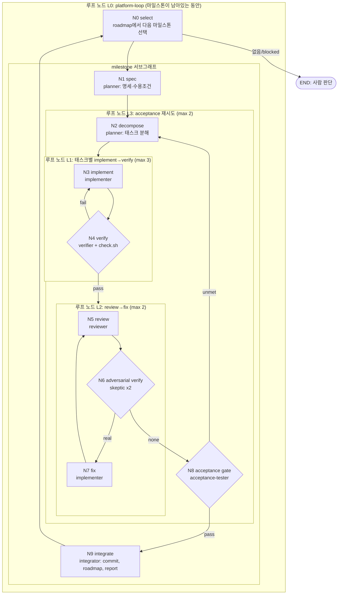

# 개발 그래프 (Dev Graph)

플랫폼 개발 과정을 **노드(node)·엣지(edge)·루프 노드(loop node)** 로 모델링한 그래프다.
실행기는 `.claude/workflows/*.js`(Claude Code Workflow 스크립트), 상태 저장소는 `harness/roadmap.yaml`,
노드 실행자는 `.claude/agents/*.md`, 게이트는 `scripts/harness/check.sh` 다.

## 그래프

## 노드 정의

| 노드 | 종류 | 실행자(agent) | 입력 | 출력 | 실패 시 |
|---|---|---|---|---|---|
| N0 select | 상태 읽기 | (스크립트) `roadmap.py next` | roadmap.yaml | 마일스톤 id | 없으면 루프 종료 |
| N1 spec | task | planner | 마일스톤 goal/acceptance, research_notes/ | `docs/specs/<id>.md`, 수용조건 목록 | - |
| N2 decompose | task | planner | spec | 태스크 목록(id, 파일 범위, 독립 여부) | - |
| N3 implement | task | implementer | 태스크 + 이전 verify 피드백 | 코드/테스트 변경 | L1 재시도 |
| N4 verify | gate | verifier | 작업 트리 | ok/failures | L1 재시도, 초과 시 blocked |
| N5 review | task | reviewer | diff | findings(blocking/minor) | - |
| N6 adversarial verify | gate | reviewer(skeptic) ×2 | finding | real/refuted | - |
| N7 fix | task | implementer | 확정된 findings | 코드 변경 | L2 재시도 |
| N8 acceptance | gate | acceptance-tester | spec 수용조건 | passed/unmet | L3 재시도, 초과 시 blocked |
| N9 integrate | task | integrator | 전체 결과 | commit, roadmap status, `reports/milestones/<id>.md` | - |

## 루프 노드 규칙

- 모든 루프는 **종료 조건 + 최대 반복 수**를 갖는다. 최대치를 넘으면 `blocked` 로 표시하고 사람에게 넘긴다(무한 루프 금지).
- 루프의 각 반복은 이전 반복의 **구조화된 피드백**(failures, findings, unmet)을 입력으로 받는다. 피드백 없는 재시도는 금지.
- 게이트 노드는 반드시 **실행 가능한 검증**(check.sh, 테스트, 수용조건 확인)을 근거로 판정한다. 판정 근거를 출력에 남긴다.
- 바깥 루프 L0 는 토큰 예산(`budget`)과 `maxMilestones` 로도 제한된다.

## 상태

- `harness/roadmap.yaml`: 마일스톤 상태(`todo | in_progress | done | blocked`), 의존성, 수용조건. `scripts/harness/roadmap.py` 로 읽고 쓴다.
- `docs/specs/<id>.md`: N1 산출물. 수용조건의 단일 출처.
- `reports/milestones/<id>.md`: N9 산출물. 무엇을 했고 무엇이 blocked 인지.

## 실행 방법

| 목적 | 명령 |
|---|---|
| 바깥 루프 전체(여러 마일스톤) | `/platform-loop` (옵션: `/platform-loop 2` = 최대 2개) |
| 마일스톤 하나 | `/milestone M1` |
| verify→fix 루프만 | `/verify-fix` |
| review→fix 루프만 | `/review-loop` |
| 상태 보기 | `/graph-status` |

워크플로는 비용이 크므로(에이전트 다수) 사용자가 위 스킬로 명시적으로 실행한다.
새 노드가 필요하면: (1) 이 문서의 표에 추가, (2) 필요하면 `.claude/agents/` 에 실행자 추가, (3) 워크플로 스크립트에 연결.
